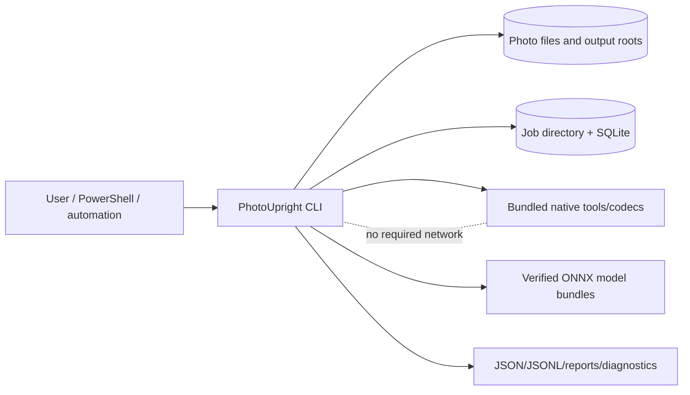

# System architecture

## Architectural style

PhotoUpright is a **Windows-first modular monolith**: one deployable CLI process with strongly separated domain, application, infrastructure, and presentation layers. Native executables/libraries may run in-process or as supervised child processes, but they are integrations rather than architectural authorities.

This shape minimizes installation and operational complexity while supporting replacement of uncertain technology choices after spikes.

## Context



## Logical layers

### Domain

Pure types and rules:

- orientation transforms and composition;
- candidate evidence and feature values;
- calibrated decision and reason codes;
- file/job lifecycle states;
- output/metadata/JPEG policies;
- invariants and errors.

The domain may depend only on the base class library and its own abstractions. It may not reference CLI, SQLite, Windows APIs, ONNX, ExifTool, Magick.NET, or console rendering.

### Application

Use cases and orchestration:

- doctor/inspect;
- discover and scan;
- seal plan;
- review overrides;
- apply/verify/recover/undo;
- model and job lifecycle;
- benchmark/report.

Application services depend on domain interfaces and ports.

### Infrastructure

Adapters:

- Windows filesystem/handle and atomic replace;
- SQLite job store;
- metadata subprocess;
- JPEG/raster codecs;
- ONNX runtime/provider;
- model registry;
- clocks, digests, process supervision, logs.

### Presentation

System.CommandLine command tree, human renderer, JSON/JSONL serializer, PowerShell completion, and exit-code mapping.

## Components

| ID | Component | Responsibility | Depends on |
| --- | --- | --- | --- |
| COMP-CLI | CLI Host | Command parsing, help, completion, exit codes, cancellation, stdout/stderr discipline. | COMP-CONFIG;COMP-CAPABILITIES;COMP-PLANNER;COMP-EXECUTOR;COMP-REVIEW;COMP-REPORTING |
| COMP-CONFIG | Configuration | Layered configuration, schema validation, profiles, redaction, effective-config reporting. | — |
| COMP-CAPABILITIES | Capability Probe | Detect OS, filesystem, codecs, runtimes, models, native tools, and operation-specific support. | COMP-CODEC;COMP-METADATA;COMP-INFERENCE;COMP-FILESYSTEM |
| COMP-DISCOVERY | Input Discovery | Deterministic traversal, filters, response files, identities, aliases, reparse and cloud-file policy. | COMP-FILESYSTEM;COMP-CONFIG |
| COMP-METADATA | Metadata Service | Read/write governed metadata through ExifTool adapter; orientation semantics; metadata diff and policy. | COMP-NATIVE |
| COMP-CODEC | Codec Service | Bounded decode, thumbnails, format capability matrix, safe encode, image property inspection. | COMP-NATIVE |
| COMP-TRANSFORM | Transform Service | Compose EXIF and inferred transforms; JPEG DCT transforms; raster transforms; output normalization. | COMP-CODEC;COMP-METADATA;COMP-NATIVE |
| COMP-INFERENCE | Inference Runtime | Run pinned ONNX models through a provider-agnostic interface and expose deterministic tensors/results. | COMP-MODELS |
| COMP-MODELS | Model Registry | Manifest, digests, compatibility, install, quarantine, activation, rollback, provenance. | COMP-FILESYSTEM |
| COMP-FEATURES | Orientation Feature Extractor | Convert detections/landmarks into interpretable rotation evidence and multi-face summaries. | COMP-INFERENCE |
| COMP-CALIBRATION | Confidence Calibration | Map evidence to calibrated probabilities and uncertainty diagnostics for a policy version. | COMP-FEATURES |
| COMP-POLICY | Decision Policy | Apply thresholds, margins, evidence rules, metadata priors, sequence tie-breakers, and abstention. | COMP-CALIBRATION |
| COMP-ORIENTATION | Orientation Engine | Generate candidates, orchestrate inference/features/policy, and emit explainable decisions. | COMP-METADATA;COMP-CODEC;COMP-INFERENCE;COMP-FEATURES;COMP-CALIBRATION;COMP-POLICY |
| COMP-PLANNER | Planner | Create immutable plans, resolve destinations, detect unsupported operations, and seal provenance. | COMP-DISCOVERY;COMP-ORIENTATION;COMP-JOBSTORE;COMP-FILESYSTEM;COMP-CAPABILITIES |
| COMP-PIPELINE | Pipeline Coordinator | Bounded channels, work scheduling, resource classes, cancellation, retries, and stage metrics. | COMP-JOBSTORE;COMP-REPORTING |
| COMP-EXECUTOR | Apply Executor | Preflight, transform, metadata update, verify, commit, retry, resume, and undo orchestration. | COMP-TRANSFORM;COMP-VERIFY;COMP-FILESYSTEM;COMP-JOURNAL;COMP-JOBSTORE;COMP-PIPELINE |
| COMP-VERIFY | Independent Verifier | Reopen outputs, compare expected geometry/orientation/metadata/digests, and classify verification failures. | COMP-CODEC;COMP-METADATA |
| COMP-FILESYSTEM | Filesystem Safety Layer | Canonical paths, handles/identity, temp placement, flush, atomic replace, backups, locks, aliases, placeholders. | COMP-NATIVE |
| COMP-JOURNAL | Recovery Journal | Write-ahead intents, state transitions, commit records, recovery reconciliation, and undo provenance. | COMP-JOBSTORE;COMP-FILESYSTEM |
| COMP-JOBSTORE | Job Store | SQLite-backed jobs, manifests, plans, events, decisions, checkpoints, schema migrations, integrity. | COMP-FILESYSTEM |
| COMP-REVIEW | Review Workflow | Queue uncertain items, render evidence/thumbnail references, validate imported decisions, append overrides. | COMP-JOBSTORE;COMP-ORIENTATION;COMP-REPORTING |
| COMP-REPORTING | Events and Reporting | Structured events, human rendering, JSON/JSONL, summaries, diagnostics bundles, redaction. | — |
| COMP-BENCHMARK | Benchmark Harness | Micro, pipeline, corpus, and environment-aware benchmarks with comparable result manifests. | COMP-CODEC;COMP-INFERENCE;COMP-METADATA;COMP-EXECUTOR |
| COMP-NATIVE | Native Tool Adapter | Hardened process/native-library invocation, version probes, stderr capture, timeouts, cancellation, sandbox policy. | — |

## Dependency rules

1. Dependencies point inward: Presentation → Application → Domain.
2. Infrastructure implements ports owned by Application/Domain.
3. Cross-cutting components communicate through typed records/events, not ambient globals.
4. The CLI cannot call ExifTool/jpegtran/ONNX/SQLite directly.
5. Decision policy cannot read filesystem state or render output.
6. Metadata and pixel transform plans are composed before execution; adapters do not invent policy.
7. Verification uses a separate read path/configuration from the writer when practical.
8. Model/runtime/provider upgrades are data/configuration changes only after compatibility tests pass.
9. No third-party runtime type appears in external job/event schemas.

## Proposed solution layout

```text
src/
  PhotoUpright.Cli/
  PhotoUpright.Application/
  PhotoUpright.Domain/
  PhotoUpright.Contracts/
  PhotoUpright.Infrastructure.Windows/
  PhotoUpright.Infrastructure.Sqlite/
  PhotoUpright.Infrastructure.Metadata.ExifTool/
  PhotoUpright.Infrastructure.Imaging/
  PhotoUpright.Infrastructure.Inference/
tests/
  PhotoUpright.UnitTests/
  PhotoUpright.ContractTests/
  PhotoUpright.IntegrationTests/
  PhotoUpright.MediaGoldenTests/
  PhotoUpright.FilesystemFaultTests/
  PhotoUpright.CliGoldenTests/
  PhotoUpright.ArchitectureTests/
  PhotoUpright.EndToEndTests/
tools/
  corpus/
  evaluation/
  fixture-builder/
  package-verifier/
models/
  manifests/                 # no unverified binary committed by default
docs/
artifacts/
```

## Process model

One CLI process owns one command invocation. A job lock prevents conflicting mutators. Read-only commands may coexist when SQLite/filesystem semantics permit. ExifTool uses a supervised persistent child process per bounded metadata worker. Native codec/inference adapters own their thread-safety policy; unsafe instances are pooled or serialized.

## Concurrency

The coordinator uses bounded channels by resource class:

- discovery/identity: I/O bounded;
- metadata: subprocess bounded;
- decode: memory bounded;
- inference: provider/session bounded;
- transform: CPU/native bounded;
- verification: I/O/decode bounded;
- persistence: single-writer batches.

Backpressure prevents discovered file count from becoming memory use. Each work item carries job ID, file ID, cancellation token, retry budget, and correlation ID.

## Determinism

Given the same source bytes/identity, normalized config, model digest, runtime/provider compatibility class, calibration, and policy, planning results must be reproducible within documented numeric tolerances. Provider divergence that crosses a decision boundary is a compatibility failure, not an acceptable rounding difference.

## Security boundaries

Untrusted inputs include images, metadata, paths, response files, config, jobs, review imports, model manifests, model files, and native-tool output. Adapters impose byte/dimension/time/count limits, validate protocol framing, and classify failures. Core operation requires no network.

## Deployment boundary

Baseline distribution is self-contained `win-x64`, with a portable archive first and signed installer after qualification. Model/native assets live under a versioned application data or installation root and are verified before activation. NativeAOT and cross-platform targets are deferred until the selected adapters prove compatible.
