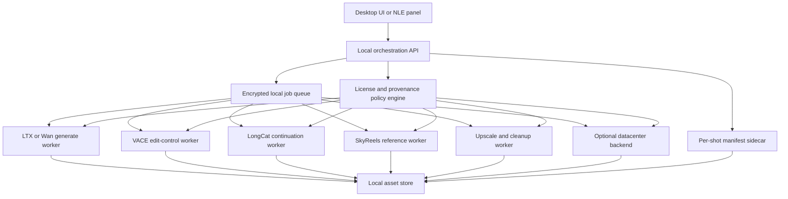
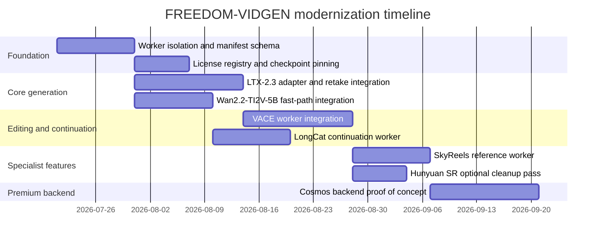

# Open Weight Image to Video Models for FREEDOM-VIDGEN

## Executive summary

As of **2026-07-20**, the strongest open-weight options for a **local, secure, prompt-friendly, production-ready** investigative-video pipeline are not one model but a **stack**. The best current pattern is: **LTX-2.3** for edit-native, high-control local generation including synchronized audio/video and retakes; **Wan2.2-TI2V-5B** for efficient 720p image-conditioned generation on prosumer hardware; **Wan2.2-I2V-A14B** or **HunyuanVideo-1.5** when you want stronger image-to-video fidelity and can tolerate heavier runtime complexity; **VACE** for all-in-one video editing and controls; and **LongCat-Video** for continuation and long-form coherence. **SkyReels-V3** is the most interesting specialist add-on for multi-reference consistency, while **Cosmos3-Super-Image2Video** is the strongest open-weight heavyweight backend if you later add datacenter rendering. citeturn9view0turn12search0turn12search4turn15view1turn19view0turn21view2turn16view2turn23view0turn25view0

For **FREEDOM-VIDGEN**, the biggest modernization mistake would be treating “best video model” as a single checkpoint decision. The open stack in 2026 is fragmented by capability: some models are best at **prompt adherence and editability**, some at **raw image-conditioned realism**, some at **reference consistency**, and some at **long-form extension**. Your project description strongly favors **offline-first operation, auditability, predictable prompting, sidecar manifests, and worker isolation** over “highest benchmark score at any cost,” which shifts the recommendation toward **LTX + Wan + VACE + LongCat**, with **SkyReels** and **Cosmos** as optional specialists. citeturn9view0turn12search0turn21view2turn19view0turn16view2turn25view0

Two licensing realities are especially important. **LTX-2** uses a community license that requires a separate paid commercial agreement for entities with at least **$10 million annual revenue**. **HunyuanVideo-1.5** is explicitly **not licensed for the EU, UK, and South Korea**. **CogVideoX-5B** requires a commercial registration flow and has a documented threshold around **1 million monthly service visits** for the free basic commercial path. By contrast, **Wan2.2**, **Open-Sora**, **LongCat-Video**, and **Pyramid-Flow** are comparatively easier to integrate from a licensing perspective, though you should still pin exact checkpoint licenses in your build manifest. citeturn11search4turn14view0turn32search0turn29view0turn19view0turn36view0

One hardware clarification is necessary: the **official GeForce RTX 5090 ships with 32 GB GDDR7**. There is **no official 64 GB RTX 5090 SKU** in NVIDIA’s published GeForce specs. In the integration estimates below, I therefore treat “RTX 5090 64GB” as a **hypothetical 64 GB-class single-GPU memory budget** rather than an official product. citeturn38search0turn38search5turn38search7

## Core open weight model landscape

The table below focuses on **relevant open-weight image-to-video-capable models** for a journalism-oriented local pipeline. Where a field is genuinely not specified in official sources, I mark it as **unspecified** rather than guessing.

| Model                              | Version or checkpoint                                                                                  | Official repo or card                                                        | License                                                                                                                                                        |                    Parameter count | VRAM minimum and recommended                                                                                                                                                                                                     | Supported resolutions and fps                                                                                                                                                                                                  | Audio support                                                                                                                                       | Capabilities                                                                                                   | Strengths                                                                                                                                                                                                        | Weaknesses                                                                                                                                                                                          | Geographic or license restrictions                                                                                                       | Quantized or FP8 support                                                                                                                                            | Recommended FREEDOM-VIDGEN role                                                                                                  |
|------------------------------------|--------------------------------------------------------------------------------------------------------|------------------------------------------------------------------------------|----------------------------------------------------------------------------------------------------------------------------------------------------------------|-----------------------------------:|----------------------------------------------------------------------------------------------------------------------------------------------------------------------------------------------------------------------------------|--------------------------------------------------------------------------------------------------------------------------------------------------------------------------------------------------------------------------------|-----------------------------------------------------------------------------------------------------------------------------------------------------|----------------------------------------------------------------------------------------------------------------|------------------------------------------------------------------------------------------------------------------------------------------------------------------------------------------------------------------|-----------------------------------------------------------------------------------------------------------------------------------------------------------------------------------------------------|------------------------------------------------------------------------------------------------------------------------------------------|---------------------------------------------------------------------------------------------------------------------------------------------------------------------|----------------------------------------------------------------------------------------------------------------------------------|
| **LTX-2.3**                        | `ltx-2.3-22b-dev`, `ltx-2.3-22b-distilled-1.1`                                                         | Lightricks repo and model card citeturn9view0turn11search2turn11search4 | LTX-2 Community License                                                                                                                                        |                                22B | Official exact minimum for the repo is unspecified; the official desktop app requires **≥16 GB VRAM** for local generation, while the repo supports **FP8 cast** and CPU/disk offload. citeturn9view1turn10view3turn10view4 | Official repo documents two-stage spatial and temporal upscalers and production I2V pipelines; exact default output grid is pipeline-dependent rather than a single fixed resolution/fps claim. citeturn39view4turn10view5 | **Yes**, synchronized audio-video; also audio-to-video and lip-dub pipelines. citeturn9view0turn10view5                                         | **I2V, T2V, V2V, A2V, retake, keyframe interpolation, lip dub**. citeturn10view5                            | Best open all-rounder for edit-native pipelines; unusually strong production features; official retake and HDR/V2V support; direct fit for newsroom editing workflows. citeturn10view5turn9view0             | License is not plain Apache/MIT; gated weights; ecosystem is still evolving quickly. citeturn11search4turn10view3                                                                               | Commercial entities with **≥$10M revenue** need a paid commercial license. citeturn11search4                                          | **FP8 cast** and **FP8 scaled-mm** are officially documented. citeturn10view4                                                                                    | **Primary local newsroom model** for generation, retakes, controlled shots, ADR/lip-dub, and non-linear edit regeneration.       |
| **Wan2.2-I2V-A14B**                | `Wan2.2-I2V-A14B`                                                                                      | Official repo and model card citeturn3view1turn12search1turn12search4   | Apache-2.0                                                                                                                                                     |   ~27B total, ~14B active per step | Official single-GPU example is **at least 80 GB VRAM**; multi-GPU FSDP/Ulysses is an official path. citeturn40view4turn12search4                                                                                             | Officially supports **480p and 720p**, **24 fps**. citeturn40view4turn12search1                                                                                                                                            | **No** in the I2V checkpoint; speech-to-video is separate. citeturn40view4turn40view0                                                           | **I2V**. citeturn40view4                                                                                    | One of the strongest open-weight image-conditioned models for fidelity and motion; strong official ecosystem; native offline path without mandatory prompt services. citeturn12search4turn40view3            | Heavy for a single consumer GPU; less comfortable than TI2V-5B for a purely local desktop workflow. citeturn40view4                                                                              | No geographic restriction stated in the official sources reviewed. citeturn3view1turn12search1                                       | Official repo emphasizes offload and dtype conversion; community GGUF quantizations exist, but they are not the official baseline. citeturn40view3turn12search9 | **High-fidelity local or small-cluster render backend** when a shot must stay close to the source image.                         |
| **Wan2.2-TI2V-5B**                 | `Wan2.2-TI2V-5B`                                                                                       | Official repo and model card citeturn3view1turn12search0turn12search3   | Apache-2.0                                                                                                                                                     |                                 5B | Official single-GPU path runs on **24 GB VRAM** such as RTX 4090; **80 GB** improves speed by removing offload. citeturn40view3                                                                                               | **720p**, **24 fps**. citeturn12search0turn40view3                                                                                                                                                                         | **No**. citeturn12search0                                                                                                                        | **T2V and I2V** in one checkpoint. citeturn12search0turn40view3                                            | Best cost-performance workhorse in the current open stack; materially easier to host locally than the 14B image model; very strong default recommendation for indie production. citeturn12search0turn40view3 | Not the absolute top image-fidelity checkpoint; prompt extension is recommended for best quality, which can complicate provenance if you leave it enabled. citeturn40view0turn40view3           | No geographic restriction stated in the official sources reviewed. citeturn3view1turn12search0                                       | Official offload + dtype conversion; community GGUF quantization exists. citeturn40view3turn12search8                                                           | **Default efficient generator** for 720p rough cuts, B-roll synthesis, and fast revision loops.                                  |
| **HunyuanVideo-1.5**               | `480P-I2V`, `480P-I2V-step-distill`, `720P-I2V`, `720P-I2V-cfg-distill`, `720P-I2V-sparse-cfg-distill` | Official repo and license citeturn3view2turn14view0turn15view5          | Tencent Hunyuan Community License                                                                                                                              |                               8.3B | Repo indicates step-distilled I2V can run if GPU memory is **>14 GB**; higher-end 720p workflows and sparse attention are heavier. citeturn15view2turn15view4                                                                | Official **480p and 720p** I2V; **50 steps** for standard variants; step-distilled **8 or 12 steps** for 480p I2V. citeturn15view5turn15view4                                                                              | **No** in the base I2V checkpoints. citeturn15view5                                                                                              | **I2V and T2V**; super-resolution checkpoints also available. citeturn15view5                               | Very strong quality-per-parameter; official 4090 speed claim for step-distilled 480p I2V is unusually good. citeturn15view0turn15view2                                                                       | Official CLI has **prompt rewriting enabled by default**, which is bad for forensic provenance unless you disable it; territorial license limitation is significant. citeturn15view4turn14view0 | **Not licensed for EU, UK, South Korea**. citeturn14view0                                                                             | Repo notes **FP8 gemm inference support**. citeturn15view1                                                                                                       | **Fast local alternative** when you need a smaller checkpoint and are outside the restricted territories.                        |
| **LongCat-Video**                  | `LongCat-Video`                                                                                        | Official repo and card citeturn19view0turn19view1                        | MIT                                                                                                                                                            |                              13.6B | Official exact minimum VRAM is not stated for the base model; official code supports single-GPU and multi-GPU inference. Avatar 1.5 adds **INT8** for reduced VRAM. citeturn19view0turn20view3                               | Officially **720p, 30 fps**, “within minutes,” with long-video continuation support. citeturn19view0turn19view1                                                                                                            | Base model: **No**. Avatar branch: **Yes**, audio-driven video generation. citeturn19view0turn20view3                                           | **I2V, T2V, video continuation**. citeturn19view0                                                           | Best open-weight choice for **long-form continuation** and minutes-long coherence; good architectural complement to LTX/Wan rather than a replacement. citeturn19view0                                        | Base model is less of a “fast desktop daily driver” than Wan TI2V-5B; fewer turnkey editing features than LTX. citeturn19view0                                                                   | No geographic restriction stated in official sources reviewed. citeturn19view0                                                        | Avatar 1.5 supports **INT8**; base model uses FlashAttention and compile-oriented optimizations. citeturn19view0turn20view3                                     | **Continuation engine** for longer investigative sequences, scene extension, and story-consistent rollouts.                      |
| **SkyReels-V3 Reference-to-Video** | `14B-720P`                                                                                             | Official repo and license citeturn3view3turn17view0                      | Skywork Community License                                                                                                                                      |                                14B | Low-VRAM mode is documented for GPUs **under 24 GB** via **FP8 weight-only quantization** and block offload. citeturn16view2turn16view5                                                                                      | Recommended **5-second 720p 24 fps**; multiple aspect ratios. citeturn16view0turn16view2                                                                                                                                   | **No** for Ref2Vid; talking-avatar checkpoint is separate and does audio lip sync. citeturn16view1turn16view2                                   | **Reference-to-video** from **1 to 4 images**. citeturn16view2                                              | Strongest open option I found for **multi-reference identity and scene consistency**. citeturn16view2turn16view0                                                                                             | Newer ecosystem, more specialist than general; license is not as permissive as MIT/Apache. citeturn17view0                                                                                       | Community license and lawful-use clauses; no region carve-out stated in the repo text reviewed. citeturn17view0                       | Official **FP8 weight-only quantization** and block offload in low-VRAM mode. citeturn16view5turn16view6                                                        | **Identity consistency specialist** for recurring people, locations, props, and multi-shot reconstructions.                      |
| **CogVideoX1.5-5B-I2V**            | `CogVideoX1.5-5B-I2V`                                                                                  | Official repo and model license pointers citeturn30view0turn32search0    | CogVideoX License                                                                                                                                              |                                 5B | Official table lists lower-memory diffusers paths for older CogVideoX variants; exact I2V 1.5 minimum is not singled out in the repo table. Repo supports FP8 and INT8 in the diffusers path. citeturn30view0                 | Officially supports “video generation at **any resolution**” within min/max rules; high-res 1.5 series supports **10-second** outputs. citeturn31view0turn30view0                                                          | **No**. citeturn30view0                                                                                                                          | **I2V, T2V, video continuation**. citeturn31view1turn31view2                                               | Mature ecosystem; lots of fine-tuning and wrapper tooling; still useful as a fallback and ecosystem-friendly model. citeturn30view0                                                                           | License is materially more restrictive than Apache/MIT; official repo recommends LLM prompt optimization; English-only prompting. citeturn32search0turn30view0                                  | Commercial use requires registration; documented free basic commercial path is capped around **1M monthly visits**. citeturn32search0 | Repo documents **FP8** and **INT8** support in diffusers/TorchAO paths. citeturn30view0                                                                          | **Compatibility fallback** when you want broad community tooling, LoRA workflows, and easier staff familiarity.                  |
| **Open-Sora 2.0**                  | `Open-Sora-v2`                                                                                         | Official repo citeturn29view0                                             | Apache-2.0                                                                                                                                                     |                                11B | Official exact minimum VRAM is unspecified; project is geared toward training and efficient production rather than tiny consumer deployments. citeturn29view0                                                                 | One model supports **256px and 768px**; official repo says one model supports **both T2V and I2V**. citeturn29view0                                                                                                         | **No**. citeturn29view0                                                                                                                          | **I2V and T2V**; text-to-image-to-video pipeline is used for best T2V quality. citeturn29view0              | Best open-source option if you want a fully open training/research stack and commercial-style reproducibility. citeturn29view0                                                                                | More “research platform” than turnkey local tool; not the first choice for a lean newsroom workstation. citeturn29view0                                                                          | No geographic restriction stated in official sources reviewed. citeturn29view0                                                        | FlashAttention-3 optional; no official FP8 consumer inference story highlighted in the retrieved repo text. citeturn29view0                                      | **Open training and reproducibility backbone** if FREEDOM-VIDGEN later adds internal fine-tuning or dataset-specific adaptation. |
| **Pyramid-Flow miniFLUX**          | `pyramid-flow-miniflux`                                                                                | Official repo citeturn36view0                                             | MIT                                                                                                                                                            | Unspecified in retrieved repo text | Official repo says it can be used with **less than 8 GB GPU memory** using multi-GPU and CPU offloading, though that is a heavily optimized path rather than the best UX. citeturn36view0                                     | Officially supports **384p** videos up to **5s** and **768p** videos up to **10s**, **24 fps**; naturally supports I2V. citeturn36view0                                                                                     | **No**. citeturn36view0                                                                                                                          | **I2V and T2V**. citeturn36view0                                                                            | Efficient and elegant architecture; attractive for mid-range hardware and experimentation. citeturn36view0                                                                                                    | Ecosystem is smaller; fewer production editing affordances than LTX or VACE-based stacks. citeturn36view0                                                                                        | No geographic restriction stated in official sources reviewed. citeturn36view0                                                        | **BF16** in official examples; sequential CPU offload supported. citeturn36view0                                                                                 | **Lean experimental branch** or secondary local generator for cost-sensitive render nodes.                                       |
| **Stable Video Diffusion XT**      | `SVD-XT`                                                                                               | Stability official repo citeturn37view1turn37view4                       | Official release is described as **research purposes** in Stability’s repo; check exact model-card terms before productization. citeturn37view1turn37view4 |    Unspecified in retrieved source | Low-VRAM knobs are documented in related Stability video codepaths; exact SVD XT minimum is not stated in the retrieved lines. citeturn37view1turn37view4                                                                    | **576×1024**, **25 frames** for SVD-XT. citeturn37view1turn37view4                                                                                                                                                         | **No**. citeturn37view1                                                                                                                          | **I2V**. citeturn37view1                                                                                    | Still useful as a small, simple legacy fallback for short image animation. citeturn37view1                                                                                                                    | Outclassed by 2025–2026 open models in realism, motion, and control. citeturn37view1                                                                                                             | Research-use framing warrants caution for commercial bundling. citeturn37view4                                                        | No official FP8 story in the retrieved sources. citeturn37view1                                                                                                  | **Legacy fallback only**.                                                                                                        |
| **Cosmos3-Super-Image2Video**      | `Cosmos3-Super-Image2Video`, optional `4Step` student                                                  | Official model card and repo citeturn23view0turn25view0                  | OpenMDW 1.1                                                                                                                                                    |                                64B | NVIDIA recommends **H200 / B200 / GB200** for Cosmos3-Super; workstation-class alternatives include **RTX Pro 6000 / H100 / B200** depending size. citeturn25view0turn26view1                                                | Supports **256p, 480p, 720p**, **10/16/24/30 fps**, **5–300 frames**, default **189 frames**. citeturn23view0turn25view0turn26view3                                                                                       | **Yes**, sound can be generated with video and muxed to MP4; NIM I2V endpoint itself is T2V/I2V-focused. citeturn23view0turn25view0turn26view6 | **I2V, T2V, text-to-image, sound-enabled generation**, broader omnimodal stack. citeturn23view0turn25view0 | Best open-weight datacenter-grade I2V option in this survey; official vLLM-Omni, Diffusers, and NIM deployment paths are unusually strong. citeturn25view0turn26view5turn26view6                            | Massive; not a consumer single-GPU model; oriented to physical-AI use cases rather than newsroom convenience. citeturn23view0turn26view1                                                        | No geographic restriction stated in retrieved sources; deployment geography is listed as **global**. citeturn23view0                  | Official 4-step distilled student exists; **FP8/NVFP4** are marked **coming soon** in the repo. citeturn26view0turn26view2                                      | **Optional datacenter backend** for premium shots and future scale-out rendering.                                                |

The practical ranking for **FREEDOM-VIDGEN** is therefore different from a pure leaderboard ranking. If your criteria are **local-first + auditability + editing utility + offline tolerance**, the shortlist is **LTX-2.3**, **Wan2.2-TI2V-5B**, **Wan2.2-I2V-A14B**, **VACE**, and **LongCat-Video**. If your criteria are instead **maximum open-weight frontier capability regardless of workstation friction**, then **Cosmos3-Super-Image2Video** enters the conversation, but as a datacenter backend rather than the default local engine. citeturn9view0turn12search0turn12search4turn21view2turn19view0turn25view0

### Integration notes and estimated runtime

The next table translates the model landscape into implementation friction. The timing ranges are **my estimates**, not vendor benchmarks. I derived them by combining official step counts, published A100/H100/4090 references where available, checkpoint size, and memory/offload behavior. Because NVIDIA’s official GeForce 5090 spec is **32 GB only**, the “64 GB-class” column is a **hypothetical single-GPU memory-headroom scenario**, not an official RTX 5090 SKU. citeturn15view0turn30view0turn38search0turn38search5

| Model                                  | Adapter complexity                                                                                                                                               | Runtime surface                                                                                                                       | Offload and quantization options                                                                                         | Estimated generation time on RTX 5090 32GB                                                                             | Estimated generation time on hypothetical 64GB-class single GPU                                        | Provenance and safety checklist                                                                                                                                                                                                                                |
|----------------------------------------|------------------------------------------------------------------------------------------------------------------------------------------------------------------|---------------------------------------------------------------------------------------------------------------------------------------|--------------------------------------------------------------------------------------------------------------------------|------------------------------------------------------------------------------------------------------------------------|--------------------------------------------------------------------------------------------------------|----------------------------------------------------------------------------------------------------------------------------------------------------------------------------------------------------------------------------------------------------------------|
| **LTX-2.3**                            | **Low to medium** if you use official Python pipelines; **low** in ComfyUI; **medium** if you expose retake/HDR/lip-dub cleanly. citeturn10view5turn8search4 | Native Python pipelines, Diffusers card, ComfyUI nodes, LTX Desktop app. citeturn9view0turn8search4turn9view1                    | Official **FP8 cast**, **FP8 scaled-mm**, CPU/disk offload. citeturn10view4                                           | **~40–90 s** for a short 720p-class distilled silent shot; **~60–150 s** with heavier two-stage HQ or audio workflows. | **~30–70 s** for comparable silent shots.                                                              | Repo supports fully local use. Weights are gated. No prompt extension is required. The desktop app has **default anonymous analytics**, so use the repo/backend directly for strict privacy. License terms matter. citeturn10view3turn9view1turn11search4 |
| **Wan2.2-TI2V-5B**                     | **Low**. A very good base adapter target. citeturn40view3                                                                                                     | Official Python repo; community Diffusers/Comfy wrappers exist, but the official runtime is the repo. citeturn3view1turn12search3 | Official offload + dtype conversion + `t5_cpu`; community GGUF exists. citeturn40view3turn12search8                  | **~30–70 s** for 5–6 s 720p I2V/TI2V.                                                                                  | **~20–50 s**.                                                                                          | Fully local is supported. **Prompt extension is recommended but optional**; keep it disabled by default for auditability, and only enable it when you are willing to log prompt transformations. citeturn40view0turn40view3                                |
| **Wan2.2-I2V-A14B**                    | **Medium** due to heavy memory requirements and likely worker specialization. citeturn40view4                                                                 | Official repo, multi-GPU FSDP/Ulysses. citeturn40view4turn40view3                                                                 | Official offload + dtype conversion; community quants exist but are secondary. citeturn40view3turn12search9          | **Not recommended** on a single 32GB card for normal production throughput; treat as backlog/offload-only.             | **~120–240 s** if you build a careful low-memory path; still not ideal versus multi-GPU or datacenter. | Fully local is supported. Prompt extension optional. No telemetry is stated in the official repo text reviewed. citeturn40view0turn40view4                                                                                                                 |
| **HunyuanVideo-1.5 480p step-distill** | **Medium** because you should expose rewrite control, step-distill, and super-res separately. citeturn15view4turn15view5                                     | Official repo and ComfyUI integration. citeturn3view2                                                                              | CPU/group offloading, sparse attention for some paths, FP8 gemm support. citeturn15view1turn15view4                  | **~50–70 s** for 480p step-distilled I2V is plausible from the official 4090 reference.                                | **~40–60 s**.                                                                                          | **Disable prompt rewriting** by default for provenance. Territorial licensing is a hard gating item. No telemetry is stated in the repo text reviewed. citeturn15view4turn14view0                                                                          |
| **HunyuanVideo-1.5 720p I2V**          | **Medium**.                                                                                                                                                      | Official repo. citeturn3view2turn15view5                                                                                          | Same as above.                                                                                                           | **~90–180 s** depending CFG-distill/offload path.                                                                      | **~70–140 s**.                                                                                         | Same checklist as above. citeturn15view4turn14view0                                                                                                                                                                                                        |
| **LongCat-Video**                      | **Medium** because continuation controls deserve a dedicated abstraction, not just “generate more.” citeturn19view0                                           | Official repo; streamlit/demo scripts; standard Python/torchrun path. citeturn19view0turn19view1                                  | FlashAttention-oriented; avatar branch adds INT8. citeturn19view0turn20view3                                         | **~80–180 s** for short 720p-class shots; longer continuation scales upward quickly.                                   | **~60–120 s** for short shots.                                                                         | Local-first, no prompt extension requirement stated, no telemetry stated. Best paired with a shot manifest that records continuation boundaries and reference-frame policy. citeturn19view0                                                                 |
| **SkyReels-V3 Ref2Vid 14B**            | **Medium** because multi-reference inputs need a stronger asset contract and validation layer. citeturn16view2                                                | Official Python repo. citeturn3view3                                                                                               | Official **FP8 weight-only** low-VRAM mode and block offload. citeturn16view5turn16view6                             | **~90–180 s** for 5 s 720p on a privacy-first local setup.                                                             | **~60–120 s**.                                                                                         | Local-first, no telemetry stated. Main safety burden is reference-image provenance and consent tracking, not network behavior. citeturn16view2turn17view0                                                                                                  |
| **CogVideoX1.5-5B-I2V**                | **Low to medium** thanks to mature ecosystem. citeturn30view0                                                                                                 | Official repo, SAT, Diffusers, many wrappers. citeturn30view0                                                                      | Diffusers + TorchAO quantized inference documented. citeturn30view0                                                   | **~100–180 s** for high-res 1.5 I2V is a reasonable planning range.                                                    | **~80–140 s**.                                                                                         | Keep external prompt optimization **off** by default. English-only prompting is official. Commercial registration and usage caps are material. citeturn30view0turn32search0                                                                                |
| **Open-Sora 2.0**                      | **High** if you want product polish; **medium** if you only need an experimental branch. citeturn29view0                                                      | Official Python/training stack. citeturn29view0                                                                                    | FlashAttention and training infra matter more than inference quantization in the cited docs. citeturn29view0          | **~120–300 s** depending resolution/path and whether you use T2I2V composed flows.                                     | **~90–240 s**.                                                                                         | Strong reproducibility story, no telemetry stated, but more engineering overhead than a newsroom usually wants for the default path. citeturn29view0                                                                                                        |
| **Pyramid-Flow miniFLUX**              | **Low to medium**. citeturn36view0                                                                                                                            | Official Python repo, notebooks, Gradio. citeturn36view0                                                                           | CPU offload and multi-GPU support; BF16 examples. citeturn36view0                                                     | **~45–90 s** for short 384p–768p shots.                                                                                | **~30–60 s**.                                                                                          | No telemetry stated; good secondary engine when you need a lightweight branch. citeturn36view0                                                                                                                                                              |
| **Stable Video Diffusion XT**          | **Low**. citeturn37view1                                                                                                                                      | Stability generative-models scripts. citeturn37view1                                                                               | Low-VRAM knobs in Stability video stack; no official FP8 path in the retrieved SVD lines. citeturn37view1turn37view5 | **~10–30 s** for short legacy shots.                                                                                   | **~8–20 s**.                                                                                           | Local and simple, but treat as legacy and verify license before bundling in a product. citeturn37view1turn37view4                                                                                                                                          |
| **Cosmos3-Super-Image2Video**          | **High**. This is a separate backend class, not a drop-in desktop model. citeturn25view0turn23view0                                                          | Diffusers, vLLM-Omni, SGLang, NIM. citeturn23view0turn26view5turn26view6                                                         | 4-step distilled student officially exists; FP8/NVFP4 are marked coming soon. citeturn26view0turn26view2             | **No realistic single-5090 plan**.                                                                                     | **Still generally no**; use workstation/datacenter hardware.                                           | Excellent serving story, but if you use **NIM** or cloud-like serving layers, you must separately govern API logs, artifact retention, and network boundaries. citeturn26view5turn26view6                                                                  |

## Editing, control, continuation, and heavyweight extensions

### Editing and control models

For FREEDOM-VIDGEN, a modern stack needs more than “generate a clip.” It needs **masked correction, reference consistency, selected-area edits, camera control, object motion, and retakes**. In 2026, the strongest open pieces are **VACE**, **LTX’s control/retake stack**, and **SkyReels-V3**. citeturn21view0turn10view5turn16view2

| Model or tool                                                                                                                  | Best use                                  | Core capability                                                                                                                                                                            | Notes for FREEDOM-VIDGEN                                                                                                                                                                                  |
|--------------------------------------------------------------------------------------------------------------------------------|-------------------------------------------|--------------------------------------------------------------------------------------------------------------------------------------------------------------------------------------------|-----------------------------------------------------------------------------------------------------------------------------------------------------------------------------------------------------------|
| **VACE Wan2.1-14B / 1.3B** citeturn21view2turn21view3                                                                      | General editing and compositional control | Official paper/repo positions VACE as an all-in-one system spanning **Move-Anything, Swap-Anything, Reference-Anything, Expand-Anything, Animate-Anything**. citeturn21view0            | This is the best candidate for your **editing/control worker** rather than your main generator. Use it for masked replacements, controlled movement, scene expansion, and reference-based edits.          |
| **LTX-2.3 ICLoraPipeline, RetakePipeline, KeyframeInterpolationPipeline, camera-control LoRAs** citeturn10view5turn39view4 | Editorial retakes and shot surgery        | Official pipelines cover **V2V/I2V transforms, time-region retakes, keyframe interpolation**, plus dedicated camera-control and motion-track control LoRAs. citeturn10view5turn39view4 | This is the cleanest route to “fix this 1.2-second segment” without regenerating the full shot. It maps extremely well to investigative workflows where a clip is mostly right but needs surgical repair. |
| **SkyReels-V3 Reference-to-Video** citeturn16view2turn16view0                                                              | Reference consistency                     | Works from **1 to 4 reference images** and is built around character/object/background consistency. citeturn16view2                                                                     | Use it for recurring presenters, recurring evidence boards, stylized location reconstructions, and “same subject across multiple shots.”                                                                  |
| **LongCat-Video-Avatar-1.5** citeturn19view0turn20view3                                                                    | Audio-driven avatar or presenter shots    | Supports audio-driven generation, continuation, multi-audio modes, and INT8 quantization in 1.5. citeturn19view0turn20view3                                                            | Not a general editing engine, but useful if FREEDOM-VIDGEN grows into explainers, voiceover standups, or anchor-style uploads.                                                                            |
| **Hunyuan 720p and 1080p super-resolution checkpoints** citeturn15view5                                                     | Upscaling and cleanup                     | Official super-resolution distilled checkpoints exist for **480→720** and **1080p SR**. citeturn15view5                                                                                 | Best used as a post-pass node, not your main generator.                                                                                                                                                   |

### Long-form and continuation models

Long-form matters for journalism because edits often need **continuation**, **bridging shots**, or **story-consistent extensions** rather than isolated 5-second clips. **LongCat-Video** is the clearest open-weight leader in this category from the official materials reviewed. citeturn19view0

| Model                                                  | Continuation strength                                   | Why it matters                                                                                                                                                                                                                                                                             |
|--------------------------------------------------------|---------------------------------------------------------|--------------------------------------------------------------------------------------------------------------------------------------------------------------------------------------------------------------------------------------------------------------------------------------------|
| **LongCat-Video** citeturn19view0turn19view1       | **Highest** among the reviewed open-weight options      | It is natively pretrained on **video continuation**, and the repo explicitly positions it for **minutes-long videos without color drifting or quality degradation**. This is the right backbone for “extend this scene” and “continue from evidence-board frame 37.” citeturn19view0    |
| **SkyReels-V3 Video Extension** citeturn16view2     | **Strong specialist**                                   | Official repo supports single-shot extension from **5s to 30s**, preserving motion continuity and subject identity. This is a strong add-on when identity preservation matters more than absolute duration. citeturn16view2                                                             |
| **Open-Sora family** citeturn29view0turn27search12 | **Research-capable**                                    | Open-Sora’s ecosystem has long emphasized extension and efficient training. It is useful if you want a more open internal R&D branch, but it is less obviously the “best newsroom continuation engine” than LongCat from today’s practical repo surface. citeturn29view0turn27search12 |
| **LTX-2 keyframe and retake flows** citeturn10view5 | **Editorial continuation, not long-world continuation** | Great for timeline-aware editing, weaker as a “world model” continuation strategy than LongCat. Best viewed as NLE-native regeneration rather than minute-scale continuation.                                                                                                              |

### Heavyweight datacenter render models

If you later add a render farm or premium backend, these are the open-weight options worth watching first.

| Model                                                                    | Why it counts as heavyweight                                                                                                                                | Suggested role                                                                          |
|--------------------------------------------------------------------------|-------------------------------------------------------------------------------------------------------------------------------------------------------------|-----------------------------------------------------------------------------------------|
| **Cosmos3-Super-Image2Video** citeturn23view0turn25view0turn26view1 | 64B, datacenter guidance from NVIDIA, official vLLM-Omni/SGLang/NIM path, optional sound generation. citeturn23view0turn25view0turn26view5turn26view6 | Premium backend for flagship shots, not the daily workstation engine.                   |
| **Cosmos3-Super-Image2Video-4Step** citeturn26view0turn26view4       | Official distilled student promising **17–25× speedup** over teacher-scale quality paths. citeturn26view0                                                | First Cosmos variant to evaluate if you want a render-service SKU.                      |
| **Wan2.2-I2V-A14B multi-GPU** citeturn40view4turn40view3             | Official single-GPU path already targets **80 GB VRAM**; multi-GPU FSDP/Ulysses is first-class. citeturn40view4turn40view3                              | Higher-fidelity image-to-video backend for a private render node.                       |
| **Wan2.2-S2V-14B** citeturn40view0turn40view3                        | Official speech-to-video path also targets **80 GB VRAM**. citeturn40view0                                                                               | Add only if newsroom use genuinely includes speaker-driven avatar or voiced explainers. |
| **Open-Sora 2.0** citeturn29view0                                     | Heavyweight not because of one checkpoint size alone, but because the ecosystem supports open training and reproducible scaling.                            | Internal R&D or future in-house post-training.                                          |

## Recommended stack and migration plan

### Recommended core stack

If I were modernizing **FREEDOM-VIDGEN** today for the goals you stated, I would not keep the current “LTX-2 + Mochi + CogVideoX” framing as-is. I would replace it with the following stack.

> **Core stack**

| Priority   | Model                                               | Why it stays in the core                                                                                                                                        |
|------------|-----------------------------------------------------|-----------------------------------------------------------------------------------------------------------------------------------------------------------------|
| **First**  | **LTX-2.3** citeturn9view0turn10view5           | It is the best fit for a real editing pipeline: local, high-control, retakes, keyframes, HDR/V2V, audio-video sync, lip-dub, and explicit production pipelines. |
| **Second** | **Wan2.2-TI2V-5B** citeturn12search0turn40view3 | This should be your daily 720p workhorse because it is genuinely practical on a high-end consumer card.                                                         |
| **Third**  | **VACE Wan2.1-14B** citeturn21view2              | This turns FREEDOM-VIDGEN from a generator into an **editorial system**.                                                                                        |
| **Fourth** | **LongCat-Video** citeturn19view0                | Use it only when continuation or long-form coherence is the actual task.                                                                                        |
| **Fifth**  | **SkyReels-V3 Ref2Vid** citeturn16view2          | Add when repeated identities and references become a bottleneck.                                                                                                |

---

> **Not recommended as core defaults**

**Mochi 1 preview** is still interesting historically, but the released preview is a **text-to-video** model, not a native current I2V workhorse, and its official documentation still frames the release as **480p preview**, with single-GPU memory around **60 GB** in the repository and **22–42 GB** in Diffusers examples. That makes it much less aligned with your 2026 I2V modernization target than LTX, Wan, or Hunyuan. citeturn34view1turn35view0turn35view2

**CogVideoX** remains worth keeping around as a compatibility ecosystem branch, but its license and commercial-registration burden make it less attractive as the centerpiece of a privacy-oriented production tool. citeturn30view0turn32search0

### Recommended production extensions

I would structure FREEDOM-VIDGEN into **role-specific workers** rather than one monolithic app process:

- **Generate worker**: LTX-2.3 or Wan2.2-TI2V-5B
- **Edit-control worker**: VACE
- **Continuation worker**: LongCat-Video
- **Reference worker**: SkyReels-V3
- **Upscale-cleanup worker**: Hunyuan SR or LTX two-stage upscaler
- **Premium backend**: Cosmos3-Super-Image2Video-4Step only if you later add private datacenter capacity

That architecture lets you preserve your offline/privacy goals while also making it obvious which worker touched a clip and which license governed it. citeturn21view2turn19view0turn16view2turn15view5turn26view4

### Suggested architecture



### Manifest sidecar and provenance design

Every rendered artifact should sit beside a **machine-readable sidecar**. I recommend storing at least:

- model family and exact checkpoint hash
- source image or video hashes
- prompt and negative prompt
- whether any prompt extension or rewrite occurred
- reference-image list and ordering
- worker name and worker version
- quantization mode
- offload mode
- clip duration, fps, resolution
- license identifier and acceptance timestamp
- user/session ID and offline flag
- safety-policy mode chosen by the operator

This matters more for investigative journalism than for typical creator tools because editorial teams need to answer: **what touched this frame, with what prompt, under what license, and with what hidden transformation steps**. Hunyuan’s default rewrite behavior and Wan’s optional prompt extension are exactly the kind of things that should always be surfaced in the sidecar instead of being invisible defaults. citeturn15view4turn40view0

### macOS and NVIDIA node split

Your current README promises broad desktop support, but the 2026 model landscape argues for a clearer split:

| Node type                      | What should run there                                                                                 | Why                                                                                                                                                                                     |
|--------------------------------|-------------------------------------------------------------------------------------------------------|-----------------------------------------------------------------------------------------------------------------------------------------------------------------------------------------|
| **macOS control node**         | UI, project management, shot manifests, local review, FFmpeg, sidecar generation, light preprocessing | LTX Desktop’s own documentation makes clear that macOS is **API-only** for local LTX generation, while real local generation is centered on NVIDIA/CUDA environments. citeturn9view1 |
| **NVIDIA render node**         | LTX, Wan, VACE, LongCat, SkyReels, Hunyuan                                                            | This is where the real local video inference belongs.                                                                                                                                   |
| **Optional private farm node** | Cosmos or heavy Wan/Hunyuan multi-GPU                                                                 | Only if you outgrow a single workstation.                                                                                                                                               |

The implication is simple: stop trying to make one machine do every role equally well. Make **macOS the secure editor/controller** and **NVIDIA the generator/editor worker plane**. citeturn9view1turn25view0

### Integration timeline



### What to remove or de-emphasize from the old README

I would de-emphasize the old claim that **Mochi 1** is one of the core included models for your 2026 I2V stack. The official Genmo release is still a **preview-era T2V model** with 480p framing and heavy memory requirements, so it is no longer one of the best default answers to your specific “open-source image-to-video production” need. I would also stop anchoring the stack around generic geographic assumptions about model origin and instead pin actual model-license restrictions in code, because the meaningful constraints in 2026 are now mostly **license clauses, territorial carve-outs, gated weights, and optional remote prompt services**. citeturn35view3turn35view0turn11search4turn14view0turn32search0turn40view0

## Legal risks, content restrictions, and watchlist

### Short legal and product-risk view

The biggest risks are not “the model might refuse a political prompt” so much as **license mismatch, hidden prompt transformation, territorial carve-outs, and operational leakage**.

**License mismatch** is the largest near-term product risk. LTX-2 is not plain Apache/MIT for commercial users above its revenue threshold. Hunyuan cannot simply be shipped or used everywhere because its license excludes the EU, UK, and South Korea. CogVideoX commercial use is not “fully free and open” in the simple MIT/Apache sense because the model license requires registration and defines service-scale thresholds. Stability’s SVD release is best treated as research-oriented unless you separately verify the exact model-card terms you will ship under. citeturn11search4turn14view0turn32search0turn37view4

**Prompt provenance** is the second risk. Wan explicitly recommends prompt extension, and Hunyuan’s official CLI exposes prompt rewriting with a default-on behavior in the documented arguments. For journalism, those should be **opt-in and logged**, not invisible defaults. citeturn40view0turn15view4

**Operational leakage** is the third risk. LTX Desktop itself documents minimal anonymous analytics enabled by default, and optional API modes in multiple ecosystems can send prompts and media externally. If FREEDOM-VIDGEN is supposed to be a hardline local/private tool, you should prefer direct repo-based inference workers over convenience desktop/API modes, and you should hard-disable optional remote prompt expansion, rewriting, or cloud text encoding unless the operator explicitly opts in. citeturn9view1turn40view0turn15view4

### Monthly watchlist

I would monitor these items every month:

| Watch item                                                                                                                 | Why it matters                                                                                                                |
|----------------------------------------------------------------------------------------------------------------------------|-------------------------------------------------------------------------------------------------------------------------------|
| **LTX-2 license changes and FP8/NVFP4 releases** citeturn11search4turn10view4                                          | LTX is strategically important for your stack; changes here directly affect commercial viability and workstation performance. |
| **Wan2.2 prompt-extension defaults, native quants, and future 14B local-friendly variants** citeturn40view0turn40view3 | Wan is your best efficiency/quality workhorse family.                                                                         |
| **HunyuanVideo territorial license updates** citeturn14view0                                                            | A single license revision could make Hunyuan either much more usable or completely unsuitable for your deployment geography.  |
| **SkyReels-V3 and LongCat-Video-Avatar updates** citeturn19view0turn16view1                                            | These are the two most compelling specialist stacks for reference consistency and audio-driven video.                         |
| **Cosmos3-Super-Image2Video-4Step and forthcoming FP8/NVFP4** citeturn26view0turn26view2                               | This determines whether Cosmos becomes a practical private render-farm backend.                                               |
| **CogVideoX license revisions** citeturn32search0                                                                       | The tooling ecosystem is excellent, so any simplification in terms would improve its product fit.                             |
| **Open-Sora 2.x inference ergonomics** citeturn29view0                                                                  | If Open-Sora becomes more turnkey on local inference, it could become a stronger core option for a fully open stack.          |

The bottom line is that **FREEDOM-VIDGEN should modernize into a multi-worker local newsroom video system**, not just “upgrade a model folder.” If you want the shortest high-confidence path, prioritize **LTX-2.3 + Wan2.2-TI2V-5B + VACE + LongCat**, add **SkyReels-V3** when identity consistency becomes painful, and only add **Cosmos** once you are ready for a true heavyweight backend. citeturn9view0turn12search0turn21view2turn19view0turn16view2turn25view0

---

## Dev Spec Research

## Executive recommendation

This project is a strong fit for a **professional, offline, Windows-first CLI application**. The best architecture is not a monolithic “AI rotates photos” tool; it is a **hybrid image pipeline** that first resolves any valid EXIF orientation metadata, then falls back to a **selfie-optimized content analysis stage** only when metadata is missing, stripped, or wrong. That approach aligns with what the ecosystem already does well—Pillow and ImageMagick can canonicalize EXIF orientation, ExifTool can preserve and rewrite metadata across many formats, and JPEG tooling such as `jpegtran` supports lossless 90-degree transforms—while content-aware face analysis fills the gap left by metadata-only workflows. citeturn22view5turn22view6turn24view0turn27search2turn27search3

For your specific use case, the most important research result is this: because the photos are **mostly selfies**, the computer-vision side can be optimized for a very narrow and favorable problem. MediaPipe’s current Face Detector explicitly outputs **face locations and facial key points** including the left eye, right eye, nose tip, mouth, and ear-region points, and its short-range BlazeFace model is explicitly optimized for **selfie-like images from a smartphone camera or webcam**. MediaPipe’s Face Landmarker then provides an escalation path with **478 3D landmarks** when the quick pass is uncertain. That makes a two-stage detector especially well-suited here. citeturn22view0turn22view2turn22view1turn22view3

The correct product shape is therefore a **CLI-first batch processor** with professional safeguards: dry-run mode, explicit confidence thresholds, separate output directories, metadata preservation, lossless JPEG rotation where possible, a review queue for ambiguous photos, and a manifest database so every decision is auditable and reversible. Existing image apps already expose parts of this problem—FastStone and XnView both support EXIF-based and lossless JPEG rotation, and digiKam recently added a deep-learning auto-rotate feature based on content analysis—but they are either general-purpose interactive applications or primarily metadata-driven tools. There is still room for a high-end, automation-oriented CLI designed around large selfie libraries on Windows. citeturn28view2turn28view3turn28view0

## Existing assets you can leverage immediately

### Metadata and rotation tooling

The metadata layer is unusually strong, which reduces the amount of custom code you actually need to invent. Pillow’s `ImageOps.exif_transpose()` will apply EXIF orientation and remove the orientation metadata after transposition. ImageMagick’s `-auto-orient` does essentially the same thing, and its documentation is explicit that it reads and resets the EXIF orientation field before applying the appropriate 90-degree transform. Both are excellent for the first-pass normalization step. citeturn22view5turn22view6

ExifTool is the most valuable integration asset in the project. Its official repository describes it as a full-featured command-line application for reading and writing metadata across a very wide set of file types, including JPEG, TIFF, PNG, WEBP, HEIC, HEIF, AVIF, many RAW formats, and more. For a high-end production CLI, that matters because the orientation problem is not only about pixels; it is also about **preserving EXIF, XMP, IPTC, dates, and vendor-specific metadata** after transforms. ExifTool is not just convenient here; it is the safest way to keep this app from becoming a metadata-destroyer. citeturn24view0

For JPEG output quality, the key asset is `jpegtran`. The jpegtran documentation describes it as a **lossless transformation tool for JPEG files** that rotates by rearranging compressed DCT data without fully decoding and re-encoding the image, avoiding generational loss. JPEGclub’s documentation also notes that lossless rotation is included in current IJG software. This means the app should not naively open every JPEG in Pillow and resave it if all that is needed is a 90, 180, or 270-degree correction. citeturn27search2turn27search3turn27search4

### Vision models and runtime choices

For the content-analysis layer, MediaPipe is the strongest fit for a selfie-heavy Windows batch utility. The current Python setup guide says MediaPipe Tasks supports **Windows, macOS, Linux, and Python 3.9+**, and the Face Detector / Face Landmarker task docs are current and explicit. The detector outputs six key facial points; the landmarker outputs 478 3D landmarks, blendshape scores, and pose-related transforms. MediaPipe’s own packaging guide even includes PyInstaller-specific handling for `.task` model files, which is unusually helpful for desktop distribution. citeturn26view0turn22view0turn22view1turn22view3

OpenCV remains a viable secondary integration. The OpenCV Zoo’s YuNet model is described as **light-weight, fast, and accurate**, and as of 2026 it includes a dynamic-input model variant designed for newer OpenCV ONNX Runtime integration. YuNet is attractive for a minimal dependency footprint and very fast face detection, but the official material surfaced here is stronger on detection than on a complete orientation pipeline, whereas MediaPipe provides a more immediately useful “detector plus richer landmark fallback” story for this specific application. citeturn22view4turn2search2turn2search5

### Format support, CLI UX, packaging, and state

Common formats are straightforward. Pillow provides broad image format support, and `pillow-heif` adds HEIF/HEIC support as a Pillow plugin, with documented registration via `register_heif_opener()` and explicit handling of image metadata through Pillow’s `info` dictionary. On Windows, `pillow-heif` recommends using prebuilt binaries rather than building from source, which is a practical packaging signal for this project. citeturn26view2turn22view7turn25search0turn25search4

For the CLI surface itself, Typer is a strong fit because it is designed for rich command trees, automatic help, and completion; Rich provides multi-task progress bars that work well with threaded or process-based work; and Textual is a credible optional path if you later want a TUI review mode without abandoning the terminal-first product direction. citeturn22view8turn22view9turn15search0turn15search1

For packaging, PyInstaller is the obvious Windows distribution choice. Its documentation says it bundles the interpreter and dependencies so users do not need Python installed, but its own manual also makes clear that **one-folder mode is easier to debug** and that **one-file mode starts more slowly** because it extracts to a temporary directory at runtime. For an image-processing CLI with model files and helper binaries, that pushes the recommendation clearly toward **one-folder for development and early releases**, with one-file only after the project is stable. citeturn22view10turn23view0

For runtime state and auditability, SQLite is an excellent embedded store. The official site describes it as a **small, fast, self-contained, high-reliability, full-featured SQL database engine**, which makes it ideal for recording per-file decisions, hashes, output paths, confidence scores, and rollback information without introducing an external service dependency. citeturn4search1

## What fits the project and what does not

What fits best is a **hybrid, offline, configurable batch processor** that treats metadata and content analysis as two separate decision systems. The metadata-first step is cheap and deterministic. The vision stage should only run when needed, which keeps the tool fast on healthy photo libraries and focused on the subset of images where automation actually adds value. That is how existing tools separate concerns too: metadata-aware tools like XnView and FastStone can auto-rotate from EXIF and use lossless JPEG transforms, but they cannot infer the correct upright orientation when EXIF is wrong or missing; digiKam’s new AI auto-rotate plugin exists precisely because metadata-only workflows do not solve the full problem. citeturn28view3turn28view2turn28view0turn28view1

What does **not** fit is relying on image width and height alone. A portrait selfie can be stored as landscape pixels with an EXIF orientation hint, or it can be physically sideways with no usable hint at all. ImageMagick’s documentation is explicit that `-auto-orient` does nothing if the EXIF profile was stripped, and it also warns that images previously “corrected” without resetting EXIF can end up being corrected again incorrectly. That warning is important: it is the clearest evidence that metadata-only auto-rotation is inadequate for the libraries that motivate this tool. citeturn22view6

It also does not fit to run the **478-landmark model on every single photo from the outset**. MediaPipe’s detector already emits enough semantic points to solve many upright-orientation cases quickly, especially in selfie-like images, and BlazeFace short-range is explicitly optimized for that domain. The richer Face Landmarker should be treated as the ambiguity resolver, not the default path for every frame. That is how you keep the product fast enough to feel “industry-standard” instead of “lab demo.” citeturn22view0turn22view2turn22view3

The Windows-native GUI-first route also does not fit the initial product goal as well as a CLI-first architecture. There is nothing wrong with a GUI eventually, but the present ecosystem gives you a very mature and fast path to a serious CLI on Windows: Python wheels for Pillow and OpenCV, MediaPipe Tasks on Windows, Typer for command structure, Rich for progress, and PyInstaller for packaging. That combination gets you to a shippable tool faster than building a custom native shell around the computer-vision logic from day one. citeturn26view0turn22view8turn22view9turn22view10

## Recommended architecture

The recommended architecture is a **core engine with pluggable detectors** and a CLI shell around it. The shell handles discovery, configuration, manifests, progress, and review workflows. The engine handles image normalization, orientation scoring, output writing, metadata preservation, and rollback bookkeeping. This separation is important because it lets you ship a serious CLI first, and later add a TUI or GUI without rewriting the computer-vision logic. Typer and Rich are already designed to support larger command trees and long-running task displays, and Textual remains available for a future review console. citeturn22view8turn22view9turn15search0turn15search1

A strong architecture for this product looks like this:

```text
CLI Layer
├── config loading
├── file discovery
├── progress / logging / prompts
├── dry-run / apply / review / restore commands
└── manifest inspection

Application Layer
├── job planner
├── rotation decision service
├── confidence / escalation policy
├── output writer
└── rollback manager

Adapters
├── Pillow adapter
├── ExifTool adapter
├── JPEGTran adapter
├── MediaPipe detector adapter
├── MediaPipe landmarker adapter
└── HEIF plugin adapter

Persistence
├── SQLite job database
├── JSONL operation log
└── sidecar review exports
```

The **decision pipeline** should be deterministic and multi-stage. First, open the file safely and inspect metadata. If the image has a valid EXIF orientation, apply it to a working image and reset the logical orientation state. Second, generate a small thumbnail for analysis. Third, test the image at `0`, `90`, `180`, and `270` degrees with the fast MediaPipe Face Detector. Fourth, compute a geometry-based score from the detector’s key points. Fifth, if the margin between the top two rotations is below threshold, escalate the candidates to the Face Landmarker and compute a richer score from the facial mesh. Sixth, if the final confidence is high enough, write the corrected image; otherwise, place the item in a review queue. The availability of six key points from the detector and 478 landmarks from the landmarker is what makes this staged design practical. citeturn22view0turn22view1turn22view3

The **write pipeline** should then branch by format. For JPEG, the correct implementation path is to use `jpegtran` whenever the change is a 90-degree multiple and no pixel-level rewrite is needed, because that preserves quality. For HEIC/HEIF and non-JPEG formats, use Pillow plus `pillow-heif` where applicable, then rely on ExifTool to normalize or restore metadata consistently. ExifTool’s broad read/write support across image families is the strongest reason to keep metadata handling as a dedicated adapter rather than embedding ad hoc metadata writes into the engine. citeturn27search2turn27search3turn24view0turn25search0

For concurrency, keep the model straightforward. File discovery and metadata inspection can be parallelized. Thumbnail creation and inference can run through a worker pool. Rich explicitly supports progress displays for concurrent tasks in threads or processes, and Python’s `concurrent.futures` provides the standard primitives for both. The safest default for the first release is a bounded worker count, not “max everything,” because these jobs touch disk, decode large images, and may invoke external helpers. citeturn22view9turn22view11

## Dev spec

### Product definition

The product should be a **Windows-first CLI application** whose primary purpose is to determine and apply the correct upright orientation for still images. It is not a general photo editor, organizer, or deduplication system. Its professional differentiation is that it should combine **metadata awareness**, **content-aware selfie detection**, **lossless JPEG correction**, and **auditable batch operations** in a single toolchain. Existing consumer apps show that each of these pieces exists independently; this product’s value is in integrating them into one robust operational workflow. citeturn28view0turn28view2turn28view3

The initial supported platforms and dependencies should target **Python 3.11 or 3.12**, which fits MediaPipe Tasks on Windows, satisfies Pillow’s current Python floor, and gives you modern standard-library support such as `tomllib` for native TOML parsing. MediaPipe’s current setup guide supports Python 3.9+ on Windows, and Pillow currently requires Python 3.10+. `tomllib` is available in Python 3.11+. citeturn26view0turn26view2turn16search1turn16search17

### Functional requirements

The app must recursively scan user-selected directories, identify supported image formats, and build a file manifest before making any changes. It must support at least JPEG, PNG, TIFF, WebP, and HEIF/HEIC in the first serious release. Pillow already covers common raster formats broadly, `pillow-heif` adds HEIF/HEIC support as a Pillow plugin, and ExifTool can read/write metadata for many more formats than the core engine should claim to fully process in phase one. citeturn26view2turn25search0turn24view0

It must support these top-level commands:

```bash
orientor scan <path>
orientor apply <path>
orientor review <job-id>
orientor restore <job-id>
orientor doctor
orientor benchmark <dataset-path>
```

`scan` creates a manifest and predicted decisions without modifying files. `apply` writes outputs. `review` exports or displays the ambiguous set. `restore` reverts a previous job based on manifest state. `doctor` validates the runtime, helper binaries, and model assets. `benchmark` runs evaluation on a labeled dataset. The CLI layer should be implemented with Typer so the command tree, help, and shell completion remain maintainable as commands grow. citeturn22view8turn15search2

The app must support the following operational flags:

```bash
--dry-run
--output-dir <path>
--in-place
--include-subdirs / --no-include-subdirs
--workers <n|auto>
--detector mediapipe|opencv
--confidence-threshold <float>
--review-threshold <float>
--max-face-count <n>
--selfie-bias on|off
--jpeg-mode lossless|reencode
--metadata-mode preserve|minimal
--heif on|off
--overwrite never|safe|always
--log-jsonl
```

The output policy should default to **out-of-place writes** into a mirrored directory structure. In-place editing should exist, but it should be explicitly opt-in and refused when rollback metadata cannot be guaranteed. That is the right safety posture for an application meant to process large personal libraries. The rationale is reinforced by how metadata-aware applications like digiKam explicitly treat orientation normalization and tag-resetting as metadata operations that can affect future display behavior. citeturn28view1

### Decision engine and scoring logic

The rotation decision engine should implement a staged scorer.

The **fast path** runs the Face Detector against the four orthogonal rotations of a thumbnail. The detector provides six facial key points. Each rotation receives a score derived from: detector confidence, plausible eye-line geometry, nose position relative to the eyes and mouth, vertical ordering of features, and whether the largest detected face occupies a plausible selfie proportion of the frame. The detector stage is ideal here because BlazeFace short-range is explicitly optimized for selfie-like camera images. citeturn22view0turn22view2

The **escalation path** runs only when the detector result is low-margin or contradictory. In that case, the app should invoke the Face Landmarker on the top candidate rotations and score them using richer signals, including eye-centroid leveling, mouth curvature orientation, chin-versus-forehead depth and placement cues, and overall facial mesh plausibility. Because the Face Landmarker returns 478 3D landmarks and transformation-related outputs, it can disambiguate cases that a six-point detector cannot. citeturn22view1turn22view3

The scoring contract should be:

```text
if EXIF is valid and user policy allows:
    apply EXIF normalization
    if user requested metadata-only mode:
        stop
else:
    evaluate 4 rotations with fast detector
    if score margin >= strong_margin:
        select best rotation
    else:
        evaluate top candidates with landmarker
        if strong enough:
            select best rotation
        else:
            mark for review
```

The engine must be **idempotent**. If it processes the same corrected output again, it should choose `0°` or an equivalent “no further change” result. This must be a tested invariant, not just a hope. Pytest is the right framework for the test suite, and Hypothesis is a very good fit for property-based checks on rotation invariants and metadata round-trips. citeturn6search0turn6search1

### File I/O and metadata rules

The app should never treat orientation as only a pixel problem. Every file operation must have an associated metadata policy. The default semantics should be:

- preserve original EXIF, XMP, and IPTC when possible;
- after writing physically rotated pixels, normalize orientation metadata to top-left / normal;
- preserve file timestamps where user policy requires it;
- store original path, hash, and output path in the job database;
- never destroy originals in default mode.

That design is directly motivated by the known behavior of metadata-aware image tooling: Pillow’s EXIF transpose removes the orientation tag after physically transposing, and ImageMagick’s `-auto-orient` reads and resets EXIF orientation. If your app rotates pixels but leaves stale orientation tags behind, it will create a second-generation bug. citeturn22view5turn22view6

For JPEG files, the writer should prefer this order:

```text
metadata read -> decision -> JPEG lossless transform -> metadata normalize/copy -> verify
```

For HEIF/HEIC files, use Pillow plus `pillow-heif` for pixel operations, then let ExifTool perform metadata normalization if the Pillow path cannot guarantee a clean metadata round-trip. `pillow-heif` documents both plugin registration and metadata handling through the `info` dictionary, which is useful, but ExifTool remains the safer “final authority” for write verification across mixed libraries. citeturn25search0turn25search1turn24view0

### Configuration, persistence, and manifests

The app should use a human-editable TOML config file, for example:

```toml
[paths]
models_dir = "models"
jobs_dir = "jobs"
temp_dir = "temp"

[formats]
enable_heif = true
jpeg_mode = "lossless"
metadata_mode = "preserve"

[inference]
backend = "mediapipe"
workers = "auto"
strong_margin = 0.20
confidence_threshold = 0.85
review_threshold = 0.65
selfie_bias = true
max_faces = 3

[review]
export_contact_sheet = true
copy_ambiguous_to = "Review Needed"

[logging]
jsonl = true
sqlite = true
```

TOML is a good fit because Python 3.11+ includes `tomllib` in the standard library, which avoids a dependency for config parsing. Job records should live in SQLite because it is self-contained, reliable, and easy to inspect when a user needs to audit a batch operation after the fact. citeturn16search1turn4search1

A minimal SQLite schema should include `jobs`, `files`, `decisions`, and `artifacts` tables. That gives you room to store pre- and post-operation hashes, chosen rotation, confidence margins, whether EXIF or content analysis drove the decision, helper binary versions, and rollback paths. The point is not database sophistication; it is reproducibility.

### Packaging and distribution

The build should target **one-folder PyInstaller bundles first**. MediaPipe’s own Python setup guide includes explicit PyInstaller packaging advice for `.task` model files, including the need to bundle model assets and collect MediaPipe package files. PyInstaller itself documents that one-folder mode is easier to debug, while one-file mode is slower to start because it extracts support files into a temporary directory at launch. That combination settles the packaging decision for the initial release: one-folder for production maturity, optional one-file later for convenience. citeturn26view0turn23view0

The packaged bundle should include:

```text
orientor.exe
/models/face_detector.task
/models/face_landmarker.task
/bin/exiftool.exe
/bin/jpegtran.exe
/lib/... PyInstaller-collected dependencies
```

Resource lookup should use the same runtime path resolution pattern MediaPipe documents for PyInstaller with `sys._MEIPASS`. That is not an optional nice-to-have; it is the supported packaging path in the vendor documentation. citeturn26view0

### Quality bar and user experience

To rival industry-standard tooling, the product needs high operational polish even though its core feature is “just rotate photos.” That means a polished CLI experience with structured help, shell completion, dry-run reports, per-phase progress bars, concise final summaries, and machine-readable logs. Typer and Rich are purpose-built for this layer. citeturn22view8turn22view9

A strong `apply` run should end with output like this:

```text
Scanned:              18,442
Already upright:      13,990
Fixed from EXIF:       2,017
Fixed by detector:     1,846
Fixed by landmarker:     411
Sent to review:          178
Errors:                    0

Output dir: D:\Photos-Oriented
Job ID: 2026-07-21T18-42-11Z
Manifest: jobs\2026-07-21T18-42-11Z\job.sqlite
Log: jobs\2026-07-21T18-42-11Z\operations.jsonl
```

That sort of summary is not cosmetic. It is the difference between a trustworthy automation tool and a black box.

### Test strategy

The test plan should be split into four layers.

The **unit layer** tests rotation math, EXIF normalization rules, helper invocation contracts, manifest writing, and rollback behavior. Use Pytest for this. citeturn6search0

The **property layer** uses Hypothesis to assert invariants such as: applying the chosen transform twice should not keep rotating; rotating a known-upright image into the four orthogonal positions should always be recoverable; metadata normalization should converge to a canonical state. citeturn6search1

The **integration layer** uses a curated labeled corpus of real-world photos: upright selfies, upside-down selfies, sideways selfies, mirror selfies, group selfies, screenshots, dark images, low-resolution images, and deliberately ambiguous cases. The benchmark command should report exact match accuracy over the four-way rotation classification problem, plus precision and recall for the “safe to auto-apply” threshold.

The **packaging layer** validates the actual Windows bundle: model assets found at runtime, ExifTool and `jpegtran` invoked correctly from the packaged executable, Unicode paths processed successfully, and dry-run / apply / review / restore functioning end-to-end.

## Delivery roadmap and major risks

The fastest credible roadmap is to build this in **three stepped releases** rather than one “big bang.” The first release should be a metadata-first professional utility: file discovery, EXIF normalization, safe output handling, manifests, rollback, logs, and JPEG lossless rotation. That is already valuable because many broken libraries are broken only at the metadata/display layer. The second release adds the fast detector-based content analysis. The third release adds landmark escalation, an ambiguity review workflow, and a benchmark harness. This sequencing uses the ecosystem in the same layered way the underlying tools already encourage. citeturn22view5turn22view6turn27search2turn22view0turn22view1

The biggest technical risk is **false confidence** rather than raw implementation difficulty. MediaPipe is currently documented as a Solutions Preview / early release in its task docs, so you should pin exact versions and keep the detector backend behind an abstraction boundary. That way, if packaging or model behavior changes in a future release, you can swap or pin without breaking the entire application contract. citeturn26view0turn22view0turn22view1

The second risk is **format and metadata complexity**. The app can easily appear “correct” while quietly stripping metadata or introducing stale orientation tags. That is why ExifTool needs to be treated as a first-class dependency, not a late add-on. The ecosystem evidence is clear: digiKam itself ships ExifTool as a metadata backend, and ExifTool’s own support matrix is far wider than what you want to replicate manually. citeturn28view0turn28view1turn24view0

The third risk is **over-distribution too early**. PyInstaller can absolutely ship this app on Windows, and MediaPipe even documents the PyInstaller model path story, but one-file distribution has real startup and temp-extraction tradeoffs. Shipping one-folder first is the professional choice because it is easier to diagnose and support. citeturn26view0turn23view0

The final product recommendation is therefore unambiguous: build a **CLI-first, offline, Windows-targeted orientation engine** with a **metadata-first pass**, a **selfie-optimized detector pass**, **landmarker escalation for ambiguous cases**, **lossless JPEG write paths**, **ExifTool-backed metadata preservation**, **SQLite manifests**, and **PyInstaller one-folder distribution**. That is the combination that best fits both the current ecosystem and the specific problem of large selfie-heavy photo libraries. citeturn22view0turn22view1turn22view2turn24view0turn27search2turn22view8turn22view9turn23view0

---
