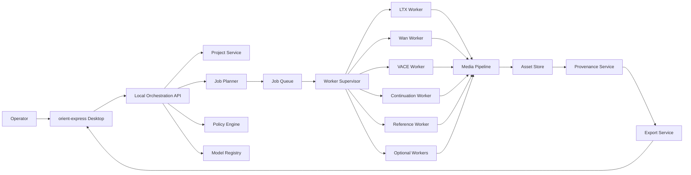
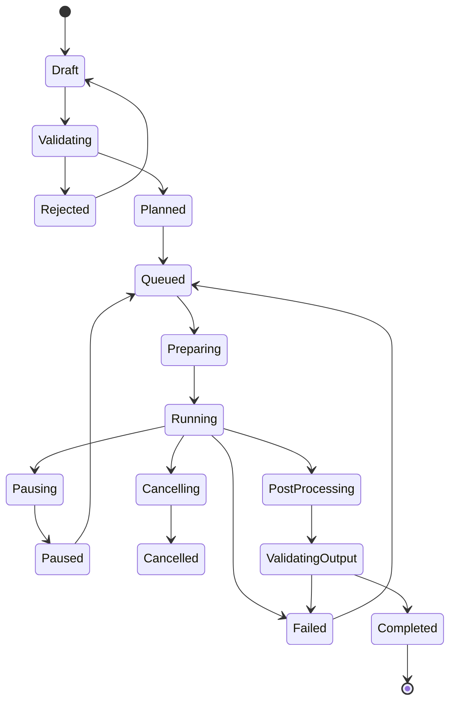

# orient-express-SYSTEM-SPEC.md

**Document ID:** FV-SYS-001  
**Version:** 1.0.0-draft  
**Status:** Proposed normative specification  
**Baseline date:** 2026-07-20  
**Project:** orient-express  
**Primary deployment target:** Windows 11 workstation with NVIDIA RTX 5090 32GB and 64GB system RAM  
**Secondary deployment target:** macOS control/editing client with a private NVIDIA render node  
**Document owner:** orient-express maintainers

---

## 0. Normative Language

The terms **MUST**, **MUST NOT**, **REQUIRED**, **SHALL**, **SHALL NOT**, **SHOULD**, **SHOULD NOT**, **RECOMMENDED**, **MAY**, and **OPTIONAL** are normative.

- **MUST / SHALL** indicates an absolute requirement.
- **SHOULD** indicates a strong recommendation that may be departed from only with documented justification.
- **MAY** indicates an optional capability.

This specification separates:

1. **Core platform requirements**, which should remain stable across model generations.
2. **Model profiles**, which are versioned and expected to change rapidly.
3. **Editorial policy**, which is configurable but must remain explicit and auditable.
4. **Security policy**, which defaults to local, offline, deny-by-default operation.

---

# 1. Executive Definition

orient-express is a **local-first, model-agnostic image-to-video generation and editorial processing platform** for journalists, documentary creators, researchers, and independent media producers who require:

- Local execution
- Private source handling
- Offline operation
- Transparent prompting
- Model choice
- Reproducible generation
- Verifiable provenance
- Extensible image-to-video workflows
- Explicit licensing boundaries
- No dependency on a single commercial service or model vendor

The system is not merely a collection of ComfyUI workflows. It is a modular application composed of:

- A desktop editing and generation client
- A local orchestration service
- A model and capability registry
- A deterministic job planner
- Isolated model workers
- An asset and project store
- A provenance subsystem
- A security and policy engine
- Optional ComfyUI interoperability
- Post-processing and export services

The core platform MUST remain functional when individual model families are replaced, deprecated, relicensed, or removed.

---

# 2. Product Mission

orient-express exists to let an independent operator create, transform, repair, extend, and organize image-conditioned video without surrendering source materials, prompts, investigative context, or editorial control to a remote provider.

The system SHALL prioritize:

1. **Local control over convenience**
2. **Explicit behavior over hidden automation**
3. **Reproducibility over opaque generation**
4. **Editorial integrity over indistinguishable asset handling**
5. **Model modularity over model lock-in**
6. **Security boundaries over monolithic convenience**
7. **Operator choice over silent defaults**

---

# 3. Scope

## 3.1 In Scope

orient-express SHALL support image-to-video workflows including:

- First-frame-conditioned image-to-video
- First-and-last-frame interpolation
- Multi-keyframe interpolation
- Reference-image-driven video
- Multi-reference subject, object, and environment conditioning
- Image-conditioned camera movement
- Image-conditioned human, character, and object animation
- Video continuation from a generated or imported frame
- Masked video editing
- Object replacement
- Background replacement
- Region-specific retakes
- Motion transfer
- Pose or trajectory conditioning
- Video-to-video restyling when used to support an image-to-video workflow
- Audio-conditioned animation where an image is a source input
- Lip synchronization where an image or generated frame is a source input
- Post-generation frame interpolation
- Super-resolution
- Denoising and restoration
- Timeline insertion and replacement
- Sidecar provenance generation
- Offline model installation and execution
- Reproducible job replay

## 3.2 Out of Scope for Version 1

The following are not core Version 1 requirements:

- Full professional non-linear editing parity with DaVinci Resolve, Premiere Pro, or Final Cut Pro
- General-purpose text-to-video as the primary product identity
- Cloud-first generation
- Multi-tenant public hosting
- Automatic publication to social platforms
- Newsroom content management
- Automated factual verification of generated scenes
- Autonomous editorial decision-making
- Silent synthetic-footage insertion into evidence timelines
- Training frontier foundation models from scratch
- Universal native inference parity across CUDA, Metal, ROCm, and CPU

Text-to-video MAY be exposed where a selected model supports it, but the system architecture and user experience SHALL be optimized around image-conditioned workflows.

---

# 4. Product Personas

## 4.1 Independent Investigative Journalist

Needs to:

- Import sensitive stills, diagrams, documents, and footage
- Animate explanatory or reconstructive visuals
- Protect source identities and source media
- Work without uploading prompts or evidence
- Preserve an audit trail of every synthetic operation
- Clearly distinguish original evidence from generated illustration
- Reproduce or defend an editorial workflow later

## 4.2 Documentary Editor

Needs to:

- Extend shots
- Create visual bridges
- Animate archival photographs
- Generate controlled camera movement
- Preserve recurring subjects and locations
- Replace or repair small regions without regenerating entire clips
- Export conventional editorial formats

## 4.3 Technical Operator

Needs to:

- Install and update model workers
- Audit dependencies
- Pin checkpoint hashes
- Configure VRAM profiles
- Diagnose failed jobs
- Benchmark model versions
- Disable networking
- Verify reproducibility

## 4.4 Researcher or Developer

Needs to:

- Add model adapters
- Expose new conditioning methods
- Compare checkpoints
- Run controlled benchmark suites
- Integrate LoRAs
- Add runtime engines without changing the application domain model

---

# 5. Design Principles

## 5.1 Local-First

All core project, source, generation, and provenance operations MUST work without internet access after installation.

## 5.2 Network Deny by Default

Production rendering MUST execute with outbound network access disabled unless a user explicitly selects a connected execution profile.

## 5.3 No Hidden Prompt Mutation

Prompt rewriting, expansion, translation, moderation, or normalization MUST NOT occur silently.

Any prompt transformation MUST:

- Be opt-in or explicitly configured
- Preserve the original prompt
- Record the transformation method
- Record the transformation model and version
- Display the final model-facing prompt before generation when requested
- Be written into the provenance record

## 5.4 Model-Agnostic Core

No core project object SHALL depend on a model-specific parameter name.

Model-specific options MUST be isolated in:

- Adapter configuration
- Capability declarations
- Model profile metadata
- Advanced parameter namespaces

## 5.5 Evidence Separation

Original evidence, transformed evidence, restored evidence, synthetic illustration, synthetic reconstruction, and fully generated footage MUST be distinct asset classifications.

## 5.6 Reproducibility

Every completed generation MUST produce enough metadata to attempt a faithful replay.

## 5.7 Explicit Licensing

The application code license MUST NOT be presented as the license governing downloaded model weights.

## 5.8 Replaceable Execution Backends

ComfyUI, Diffusers, native repositories, TensorRT, custom CUDA runtimes, and future engines MUST be treated as replaceable execution backends.

## 5.9 Graceful Degradation

A missing optional model MUST disable only the capabilities that require it. The application MUST remain usable.

## 5.10 Operator Authority

The system MAY warn, classify, or require provenance, but it MUST NOT conceal model availability, prompt changes, or technical execution choices from the operator.

---

# 6. System Context



---

# 7. Architectural Layers

## 7.1 Presentation Layer

The presentation layer consists of the desktop client and any optional local web interface.

Responsibilities:

- Project navigation
- Source import
- Shot construction
- Prompt entry
- Model recommendation display
- Job configuration
- Queue monitoring
- Result comparison
- Timeline placement
- Provenance viewing
- Export configuration
- Security state indication
- License notice presentation

The desktop client MUST NOT directly import model repositories or execute arbitrary model code.

## 7.2 Application Layer

The application layer owns platform behavior:

- Project service
- Asset service
- Job service
- Routing service
- Model registry service
- Policy service
- Provenance service
- Export service
- Benchmark service

## 7.3 Execution Layer

The execution layer contains isolated workers.

Each worker SHALL:

- Run a specific model family and runtime combination
- Expose the standard worker protocol
- Declare capabilities
- Declare resource requirements
- Receive immutable prepared jobs
- Write outputs only to assigned scratch and output locations
- Return structured diagnostics
- Operate without direct access to unrelated projects

## 7.4 Storage Layer

The storage layer SHALL contain:

- Project metadata
- Imported assets
- Generated assets
- Proxy assets
- Masks
- Reference packages
- Model metadata
- Checkpoint manifests
- Job records
- Provenance records
- Benchmark results
- Export records
- Logs
- Temporary worker data

## 7.5 Integration Layer

The integration layer MAY include:

- ComfyUI bridge
- FFmpeg
- MediaInfo
- C2PA-compatible signing or manifest tools
- Local NLE exchange
- Optional private render nodes
- Optional local language models for prompt assistance

---

# 8. Deployment Topologies

## 8.1 Single Windows Workstation

Recommended initial deployment.

```text
Windows 11
├── orient-express Desktop
├── Local orchestration service
├── Local database
├── Local asset store
├── Worker supervisor
├── CUDA model workers
├── FFmpeg pipeline
└── Optional ComfyUI bridge
```

Requirements:

- NVIDIA GPU with supported CUDA runtime
- Local SSD storage
- Outbound network firewall control
- Sufficient system RAM for model offloading
- Windows-native or WSL2-based worker execution

## 8.2 macOS Control Node + Private NVIDIA Render Node

```text
macOS
├── Desktop client
├── Project metadata
├── Review proxies
└── Secure local-network client

Private NVIDIA node
├── Orchestration endpoint
├── Model registry
├── Worker supervisor
├── Model workers
├── Full-resolution assets
└── Generation storage
```

The system MUST NOT promise identical model support between macOS and CUDA nodes.

macOS SHALL be a fully supported control, editing, review, prompting, and export client even where model execution occurs on a private NVIDIA node.

## 8.3 Air-Gapped Render Node

An air-gapped node SHALL support:

- Offline installation bundles
- Signed model manifests
- Hash verification
- Removable-media model transfer
- No runtime authentication dependency
- No cloud licence check dependency unless the model license itself makes offline use impossible

## 8.4 Private Multi-GPU Node

The architecture MAY support a private high-memory worker for:

- Large Wan models
- Cosmos-class backends
- Multi-GPU VACE
- Long-form generation
- Batch rendering
- Fine-tuning

This backend MUST implement the same worker protocol as a local single-GPU worker.

---

# 9. Core Components

## 9.1 Desktop Client

### Responsibilities

- Create and open projects
- Import source materials
- Classify assets
- Construct image-to-video jobs
- Show model recommendations
- Expose simple and advanced controls
- Compare variations
- Place outputs in a lightweight timeline
- Show worker, network, licence, and provenance state
- Export clips and manifests

### Requirements

The desktop client MUST:

- Show whether the current execution is offline
- Show the exact selected checkpoint
- Show when prompt rewriting is enabled
- Show when a remote endpoint is selected
- Prevent accidental overwrite of original evidence
- Preserve user-entered prompts
- Allow result rating and rejection
- Allow a completed job to be cloned

The desktop client SHOULD provide these primary task modes:

1. **Animate Image**
2. **Preserve Subject**
3. **Control Camera**
4. **Interpolate Keyframes**
5. **Extend Shot**
6. **Repair Region**
7. **Replace Object**
8. **Replace Background**
9. **Animate to Audio**
10. **Generate Variation**
11. **Upscale and Finish**

The user SHOULD NOT need to select a model before selecting a task.

## 9.2 Local Orchestration API

The orchestration API is the stable internal contract between clients and the platform.

Recommended base URL:

```text
http://127.0.0.1:47820/api/v1
```

Remote private-node deployments MUST use authenticated encrypted transport.

Core endpoint groups:

```text
/projects
/assets
/shots
/jobs
/workers
/models
/profiles
/provenance
/exports
/benchmarks
/security
/system
```

## 9.3 Project Service

The project service SHALL manage:

- Project identity
- Project root
- Editorial classification
- Asset references
- Shot records
- Project settings
- Security profile
- Export policy
- Project-level provenance chain

## 9.4 Asset Service

The asset service SHALL:

- Import without modifying source files
- Compute content hashes
- Detect media type
- Extract metadata
- Generate proxies
- Classify editorial role
- Track derivatives
- Preserve parent-child relationships
- Restrict writes to original evidence

## 9.5 Job Planner

The job planner converts a user request into a model-independent execution plan.

Inputs:

- Task type
- Source assets
- Prompt
- Negative prompt
- desired duration
- desired resolution
- desired frame rate
- desired motion
- preservation priorities
- performance profile
- security profile
- installed models
- worker health
- licensing constraints
- hardware resources

Outputs:

- Validated job
- Recommended model profile
- Alternative model profiles
- Prepared execution graph
- Resource estimate
- Expected limitations
- Provenance plan

## 9.6 Capability Router

The router SHALL select a compatible worker based on hard constraints before quality scoring.

Hard constraints include:

- Task support
- Input count
- Required mask support
- Required audio support
- Minimum or maximum resolution
- Maximum frame count
- Available VRAM
- Supported precision
- Installed checkpoint
- Licence eligibility
- Geographic eligibility
- Offline compatibility
- Worker health

The router MUST NOT select a worker that violates a hard constraint.

## 9.7 Job Queue

The queue SHALL support:

- Priority
- Pause
- Resume where supported
- Cancellation
- Retry
- Dependency chains
- Batch jobs
- Variation jobs
- Job groups
- Scheduled local execution
- Resource locking
- Recovery after application restart

## 9.8 Worker Supervisor

The supervisor SHALL:

- Start and stop workers
- Allocate GPU devices
- Reserve VRAM profiles
- Enforce network policy
- Mount project-scoped paths
- Capture structured logs
- Detect crashes
- Terminate hung processes
- Clean scratch storage
- Verify worker versions
- Report worker capabilities
- Enforce concurrency limits

## 9.9 Model Registry

The model registry is the authoritative model source of truth.

It SHALL record:

- Model family
- Exact checkpoint
- Version
- Source repository
- Artifact hashes
- Runtime
- Supported capabilities
- Required dependencies
- Supported precision
- VRAM profiles
- Licence
- Geographic constraints
- Commercial constraints
- Network requirements
- Prompt transformation defaults
- Known limitations
- Test status
- Benchmark status
- Deprecation status

## 9.10 Media Pipeline

The media pipeline SHALL perform:

- Decode
- Frame extraction
- Colour conversion
- Resize and crop
- Alpha handling
- Mask preparation
- Audio decode
- Frame assembly
- Frame-rate conversion
- Interpolation
- Upscaling
- Audio muxing
- Proxy creation
- Output validation
- Thumbnail creation

The media pipeline MUST preserve original source files.

## 9.11 Provenance Service

The provenance service SHALL create an immutable record for:

- Imports
- Transcodes
- Proxy creation
- Prompt transformations
- Generations
- Retakes
- Edits
- Continuations
- Upscaling
- Exports

## 9.12 Security and Policy Engine

The policy engine SHALL enforce:

- Network mode
- Worker permissions
- Model licence eligibility
- Source classification constraints
- Remote execution restrictions
- Prompt transformation disclosure
- Export disclosure policy
- Original-evidence protection
- Custom-node restrictions
- Untrusted artifact restrictions

## 9.13 ComfyUI Bridge

ComfyUI MAY be used for:

- Prototyping
- Advanced workflow authoring
- Visual debugging
- Community workflow import
- Model support before a native adapter exists

ComfyUI MUST NOT be treated as:

- The canonical project database
- The canonical job schema
- The security boundary
- The provenance authority
- The model registry
- The application API

Imported workflows MUST be treated as untrusted until reviewed and pinned.

---

# 10. Domain Model

## 10.1 Project

```typescript
interface Project {
  id: string;
  name: string;
  createdAt: string;
  updatedAt: string;
  rootPath: string;
  editorialMode: "standard" | "journalistic" | "forensic";
  securityProfileId: string;
  defaultRenderProfileId: string;
  assetIds: string[];
  shotIds: string[];
  tags: string[];
}
```

## 10.2 Asset

```typescript
interface Asset {
  id: string;
  projectId: string;
  kind: "image" | "video" | "audio" | "mask" | "document" | "generated";
  editorialClass:
    | "original_evidence"
    | "transcoded_evidence"
    | "editorially_modified_evidence"
    | "ai_restored"
    | "ai_generated_illustration"
    | "ai_generated_reconstruction"
    | "fully_synthetic"
    | "reference_only";
  path: string;
  sha256: string;
  parentAssetIds: string[];
  metadata: MediaMetadata;
  createdAt: string;
  immutable: boolean;
}
```

## 10.3 Shot

```typescript
interface Shot {
  id: string;
  projectId: string;
  name: string;
  sourceAssetIds: string[];
  currentAssetId?: string;
  durationMs?: number;
  inPointMs?: number;
  outPointMs?: number;
  generationJobIds: string[];
  notes?: string;
  disclosureClass?: string;
}
```

## 10.4 Generation Job

```typescript
interface GenerationJob {
  id: string;
  projectId: string;
  shotId?: string;
  task: GenerationTask;
  status: JobStatus;

  inputs: {
    sourceImageIds: string[];
    sourceVideoIds: string[];
    referenceImageIds: string[];
    audioAssetIds: string[];
    maskAssetIds: string[];
    keyframes: KeyframeInput[];
  };

  prompt: {
    original: string;
    negative?: string;
    transformed?: string;
    transformationRecordId?: string;
  };

  output: {
    width: number;
    height: number;
    fps: number;
    frameCount?: number;
    durationMs?: number;
    codecProfile?: string;
  };

  controls: {
    seed?: number;
    motionStrength?: number;
    sourceFidelity?: number;
    identityPriority?: number;
    cameraPreset?: string;
    cameraPathAssetId?: string;
    preserveFirstFrame?: boolean;
    preserveLastFrame?: boolean;
  };

  routing: {
    requestedModelId?: string;
    selectedModelId?: string;
    selectedWorkerId?: string;
    renderProfileId: string;
    alternatives?: string[];
  };

  securityProfileId: string;
  createdAt: string;
  startedAt?: string;
  completedAt?: string;
}
```

## 10.5 Model Specification

```yaml
id: ltx-2.3-22b-distilled-1.1
family: ltx
version: "2.3"
status: supported

artifacts:
  - name: transformer
    filename: ltx-2.3-22b-distilled-1.1.safetensors
    sha256: "<required>"
    required: true

runtime:
  adapter: ltx23
  engine: native-python
  python: "3.12"
  precision:
    - bf16
    - fp8
  recommended_precision: fp8
  minimum_vram_gb: 24
  recommended_vram_gb: 32
  system_ram_gb: 64
  network_required_after_install: false

capabilities:
  image_to_video: true
  first_last_frame: true
  multi_keyframe: true
  video_to_video: true
  retake: true
  synchronized_audio: true
  lip_sync: true
  camera_control: true
  lora: true

prompting:
  hidden_rewrite: false
  optional_rewriter: false

license:
  id: ltx-2-community
  application_code_compatible: true
  checkpoint_redistribution: false
  acceptance_required: true
  commercial_constraints: true

validation:
  local_tested: false
  benchmark_profile: null
  last_verified: null
```

---

# 11. Generation Task Taxonomy

```typescript
type GenerationTask =
  | "image_to_video"
  | "reference_to_video"
  | "keyframe_interpolation"
  | "video_continuation"
  | "masked_retake"
  | "masked_replace"
  | "background_replace"
  | "object_motion"
  | "pose_conditioned_animation"
  | "camera_conditioned_animation"
  | "audio_driven_animation"
  | "lip_sync"
  | "video_to_video"
  | "upscale"
  | "frame_interpolation"
  | "restoration";
```

Each task SHALL have:

- Required inputs
- Optional inputs
- Capability requirements
- Validation rules
- Compatible model profiles
- Default output profiles
- Provenance classification
- Failure modes

---

# 12. Standard Model Adapter Contract

```python
from abc import ABC, abstractmethod

class VideoModelAdapter(ABC):
    @abstractmethod
    def inspect_capabilities(self) -> "ModelCapabilities":
        ...

    @abstractmethod
    def validate_job(self, job: "GenerationJob") -> "ValidationResult":
        ...

    @abstractmethod
    def estimate_resources(self, job: "GenerationJob") -> "ResourceEstimate":
        ...

    @abstractmethod
    def prepare_job(self, job: "GenerationJob") -> "PreparedJob":
        ...

    @abstractmethod
    def generate(self, job: "PreparedJob", events: "EventSink") -> "GenerationResult":
        ...

    @abstractmethod
    def cancel(self, job_id: str) -> None:
        ...

    @abstractmethod
    def health(self) -> "WorkerHealth":
        ...

    @abstractmethod
    def diagnostics(self, job_id: str) -> "Diagnostics":
        ...
```

## 12.1 Adapter Requirements

An adapter MUST:

- Be versioned independently
- Declare exact supported checkpoints
- Reject unsupported parameters
- Normalize outputs into the platform result schema
- Return actual execution parameters
- Return the model-facing prompt
- Report peak VRAM where measurable
- Report runtime duration
- Return warnings
- Preserve random seed information
- Identify non-deterministic operations
- Produce structured failure codes

An adapter MUST NOT:

- Download arbitrary code during production inference
- Modify project source assets
- Write outside assigned mounts
- silently call a remote API
- silently rewrite prompts
- silently switch checkpoints
- silently change task semantics

## 12.2 Worker Protocol

Workers SHOULD communicate using one of:

- Local HTTP over loopback
- Unix domain socket
- Named pipe
- gRPC on a private interface

The protocol MUST support:

- Capability handshake
- Job submission
- Progress events
- Preview events
- Cancellation
- Health checks
- Diagnostics
- Graceful shutdown

---

# 13. Capability Declaration

```typescript
interface ModelCapabilities {
  imageToVideo: boolean;
  referenceToVideo: boolean;
  maxReferenceImages: number;
  videoToVideo: boolean;
  maskedEditing: boolean;
  firstFrameConditioning: boolean;
  lastFrameConditioning: boolean;
  multiKeyframeConditioning: boolean;
  videoContinuation: boolean;
  cameraControl: boolean;
  motionControl: boolean;
  poseControl: boolean;
  audioGeneration: boolean;
  audioConditioning: boolean;
  lipSync: boolean;
  retake: boolean;
  lora: boolean;
  maxFrames: number;
  supportedResolutions: ResolutionRule[];
  supportedFps: number[];
  supportedPrecisions: string[];
}
```

Capabilities MUST describe tested behavior, not merely upstream claims.

The registry SHOULD distinguish:

- `upstream_claimed`
- `adapter_supported`
- `locally_validated`
- `production_approved`

---

# 14. Routing Model

## 14.1 Constraint Phase

Candidate models are first filtered by hard constraints.

```text
Candidates =
Installed
∩ Licensed
∩ RegionAllowed
∩ OfflineCompatible
∩ TaskCompatible
∩ InputCompatible
∩ HardwareCompatible
∩ HealthyWorkers
```

## 14.2 Scoring Phase

A model SHALL be scored only after satisfying hard constraints.

Recommended normalized score:

\[
R_m =
w_qQ_m +
w_fF_m +
w_tT_m +
w_pP_m +
w_iI_m +
w_cC_m +
w_eE_m +
w_sS_m +
w_uU_m
-
w_vV_m
-
w_rR_m
-
w_lL_m
\]

Where:

- \(Q_m\): overall visual quality
- \(F_m\): source-image fidelity
- \(T_m\): temporal coherence
- \(P_m\): prompt adherence
- \(I_m\): identity consistency
- \(C_m\): controllability
- \(E_m\): editing suitability
- \(S_m\): speed
- \(U_m\): operational usability
- \(V_m\): VRAM burden
- \(R_m\): runtime fragility
- \(L_m\): licensing burden

The application MUST NOT present this as a universal objective truth.

Weights SHALL vary by task profile.

## 14.3 Example Task Profiles

### High-Fidelity Image Animation

```yaml
quality: 0.20
source_fidelity: 0.25
temporal_coherence: 0.20
prompt_adherence: 0.10
identity_consistency: 0.10
controllability: 0.05
speed: 0.05
operational_usability: 0.05
```

### Fast Editorial Preview

```yaml
quality: 0.10
source_fidelity: 0.15
temporal_coherence: 0.10
prompt_adherence: 0.10
speed: 0.30
operational_usability: 0.20
vram_burden_penalty: 0.05
```

### Investigative Reconstruction

```yaml
source_fidelity: 0.25
identity_consistency: 0.20
controllability: 0.20
prompt_adherence: 0.10
temporal_coherence: 0.10
reproducibility: 0.10
licensing_burden_penalty: 0.05
```

---

# 15. Reference Model Roles — Baseline 2026-07-20

This section is a replaceable model profile, not a permanent architectural dependency.

## 15.1 Primary General Worker

**LTX-2.3**

Recommended tasks:

- High-quality image-to-video
- First/last-frame interpolation
- Timeline retakes
- Camera control
- Synchronized audio-video workflows
- Lip-dub workflows
- Video-to-video transformations
- Editorial shot repair

## 15.2 Efficient General Worker

**Wan 2.2 TI2V-5B**

Recommended tasks:

- Fast 720p drafts
- General image animation
- B-roll generation
- Batch variation generation
- Consumer-GPU deployment
- Permissive model pack

## 15.3 High-Fidelity Heavy Worker

**Wan 2.2 I2V-A14B**

Recommended tasks:

- Source-image fidelity
- Higher-compute final shots
- Private high-memory or multi-GPU nodes

## 15.4 Editing and Control Worker

**VACE**

Recommended tasks:

- Masked replacement
- Region editing
- Object movement
- Background replacement
- Scene expansion
- Reference-driven editing

## 15.5 Continuation Worker

**LongCat-Video**

Recommended tasks:

- Shot extension
- Longer visual continuation
- Multi-segment continuity
- Slowly evolving scenes

## 15.6 Multi-Reference Worker

**SkyReels V3**

Recommended tasks:

- Recurring subject preservation
- Multiple reference images
- Subject-object-background consistency
- Multi-shot visual continuity

## 15.7 Efficient Optional Worker

**HunyuanVideo 1.5**

Recommended tasks:

- Lower-VRAM generation
- Fast distilled previews
- Optional super-resolution
- LoRA experimentation where licence conditions permit

## 15.8 Heavyweight Optional Worker

**Cosmos3-Super Image2Video**

Recommended tasks:

- Private datacenter rendering
- Maximum-quality optional shots
- Multi-GPU deployments

## 15.9 Legacy or Compatibility Workers

The following SHOULD NOT be core defaults:

- CogVideoX
- Stable Video Diffusion
- Mochi 1 preview
- Older Open-Sora checkpoints
- Older Pyramid-Flow profiles

They MAY remain available for:

- Compatibility
- Research
- Existing LoRA investments
- Low-resource fallback
- Historical benchmark comparison

---

# 16. Job State Machine



## 16.1 Status Definitions

```typescript
type JobStatus =
  | "draft"
  | "validating"
  | "rejected"
  | "planned"
  | "queued"
  | "preparing"
  | "running"
  | "pausing"
  | "paused"
  | "cancelling"
  | "cancelled"
  | "post_processing"
  | "validating_output"
  | "failed"
  | "completed";
```

## 16.2 Retry Rules

Automatic retry MAY occur only for:

- Worker startup failure
- Recoverable out-of-memory profile mismatch
- Temporary file lock
- Recoverable decoder failure
- Worker crash before sampling begins

Automatic retry MUST NOT silently:

- Change seed
- Change checkpoint
- Reduce quality
- Reduce resolution
- Enable prompt rewriting
- Change precision

Any adaptive retry MUST create a new execution attempt record.

---

# 17. Resource Planning

## 17.1 Render Profiles

```yaml
preview:
  priority: speed
  resolution: 480p
  duration_seconds: 3
  precision: fp8
  offload: allowed
  variations: 2

balanced:
  priority: balanced
  resolution: 720p
  duration_seconds: 5
  precision: fp8
  offload: allowed
  variations: 1

quality:
  priority: quality
  resolution: 720p
  duration_seconds: 5
  precision: bf16
  offload: limited
  post_upscale: true

maximum:
  priority: quality
  resolution: model_native_max
  duration_seconds: model_profile
  precision: best_supported
  offload: false
  private_heavy_worker: preferred
```

## 17.2 VRAM Admission

The worker supervisor MUST reserve GPU capacity before starting a job.

A job SHALL be admitted only if:

```text
estimated_peak_vram
+ worker_runtime_margin
+ desktop_gpu_reserve
<= configured_gpu_budget
```

The configured desktop reserve SHOULD prevent the UI and display stack from becoming unstable.

## 17.3 Out-of-Memory Recovery

The system MAY suggest:

- FP8
- Quantized checkpoint
- CPU offload
- Sequential offload
- Lower resolution
- Fewer frames
- Smaller model
- Different worker

It MUST show what changed before retry.

## 17.4 Concurrency

Default on a single 32GB GPU:

- One heavy generation worker at a time
- One lightweight preprocessing task concurrently
- Post-processing concurrency limited by memory and storage throughput

---

# 18. Prompt System

## 18.1 Prompt Record

Every job SHALL store:

- Original user prompt
- Negative prompt
- Prompt language
- Prompt template, if any
- Transformed prompt, if any
- Transformation model
- Transformation settings
- User approval state
- Model-facing final prompt

## 18.2 Prompt Assistance

Local prompt assistance MAY provide:

- Shot-language suggestions
- Motion phrasing
- Camera vocabulary
- Temporal ordering
- Subject preservation hints
- Model-specific warnings
- Prompt linting

Prompt assistance MUST be separable from prompt execution.

## 18.3 Prompt Templates

Templates SHOULD be plain, inspectable data:

```yaml
id: documentary-photo-subtle-motion
task: image_to_video
template: >
  Preserve the source image composition and identity.
  Add restrained natural motion: {motion}.
  Camera: {camera}.
  Lighting remains consistent with the source.
  Avoid introducing new people, text, logos, or objects.
```

---

# 19. Editorial Provenance

## 19.1 Asset Classes

The system SHALL distinguish:

1. `original_evidence`
2. `transcoded_evidence`
3. `editorially_modified_evidence`
4. `ai_restored`
5. `ai_generated_illustration`
6. `ai_generated_reconstruction`
7. `fully_synthetic`
8. `reference_only`

## 19.2 Provenance Record

```json
{
  "record_version": "1.0",
  "asset_id": "asset_01",
  "project_id": "project_01",
  "operation": "image_to_video",
  "classification": "ai_generated_reconstruction",
  "source_assets": [
    {
      "asset_id": "source_01",
      "sha256": "..."
    }
  ],
  "prompt": {
    "original": "...",
    "model_facing": "...",
    "rewritten": false
  },
  "model": {
    "registry_id": "ltx-2.3-22b-distilled-1.1",
    "checkpoint_sha256": "...",
    "adapter_version": "1.0.0",
    "runtime_version": "..."
  },
  "generation": {
    "seed": 123456789,
    "width": 1280,
    "height": 720,
    "fps": 24,
    "frames": 121,
    "precision": "fp8",
    "scheduler": "...",
    "parameters": {}
  },
  "environment": {
    "os": "Windows 11",
    "gpu": "NVIDIA GeForce RTX 5090",
    "driver": "...",
    "cuda": "...",
    "offline": true
  },
  "timestamps": {
    "started": "...",
    "completed": "..."
  }
}
```

## 19.3 Editorial Safeguards

The system MUST:

- Prevent generated footage from being classified as original evidence
- Preserve source hashes
- Preserve generation lineage
- Warn when a generated asset is placed in an evidence-designated track
- Allow human-readable disclosure notes
- Include synthetic classification in exports when configured

The system SHOULD support C2PA-compatible or equivalent signed export manifests, but internal provenance MUST NOT depend on a third-party cloud service.

---

# 20. Security Architecture

## 20.1 Execution Modes

### Offline Production Mode

- Outbound network denied
- Local model files only
- No package installation
- No remote APIs
- No prompt rewriting unless local
- No analytics
- No update checks
- Strict worker mounts
- Full provenance

### Connected Maintenance Mode

- Model download allowed
- Dependency resolution allowed
- Update checks allowed
- No sensitive project automatically mounted
- Separate audit log
- Explicit operator activation

### Private Node Mode

- Encrypted authenticated connection
- Local-network allowlist
- No public ingress
- Project-scoped access
- Full request and output hashes

## 20.2 Threats

The threat model SHALL include:

- Malicious Python dependencies
- Compromised model repositories
- Unsafe serialized checkpoints
- Compromised ComfyUI nodes
- Hidden telemetry
- Remote prompt expansion
- Sensitive temp files
- Thumbnail and proxy leakage
- Model workers reading unrelated projects
- Untrusted media parser exploits
- Arbitrary workflow execution
- Mutable model files
- Supply-chain replacement
- Accidental remote endpoint selection

## 20.3 Required Controls

The platform MUST implement:

- Hash-pinned model artifacts
- Dependency lockfiles
- Signed or hash-verified installation manifests
- `safetensors` preference
- Pickle checkpoint prohibition by default
- Worker-scoped filesystem mounts
- Deny-by-default outbound network
- Separate maintenance and production modes
- Temporary-directory cleanup
- No source media in crash reports
- Explicit remote-service indicators
- Original-asset immutability
- Audit events for policy changes

The platform SHOULD implement:

- SBOM generation
- Reproducible worker builds
- Container or process sandboxing
- Read-only model mounts
- Encrypted project volumes
- OS firewall rule automation
- Malware scanning of downloaded archives
- Media decoding in a constrained subprocess

## 20.4 ComfyUI Security

Custom nodes MUST be disabled in hardened mode unless:

- Source is pinned
- Commit hash is recorded
- Dependencies are locked
- Network behavior is reviewed
- Filesystem behavior is reviewed
- The node is approved in the local registry

---

# 21. Storage Specification

Recommended project layout:

```text
project-root/
├── project.json
├── assets/
│   ├── originals/
│   ├── references/
│   ├── generated/
│   ├── restored/
│   ├── proxies/
│   ├── masks/
│   └── audio/
├── shots/
│   └── <shot-id>/
├── jobs/
│   └── <job-id>/
│       ├── request.json
│       ├── plan.json
│       ├── attempts/
│       ├── logs/
│       └── result.json
├── provenance/
│   └── <asset-id>.json
├── exports/
├── benchmarks/
└── cache/
```

Global application layout:

```text
orient-express-data/
├── registry/
├── models/
├── workers/
├── runtimes/
├── licences/
├── security/
├── logs/
├── updates/
└── temp/
```

## 21.1 Original Asset Policy

Original evidence SHALL:

- Be imported read-only
- Receive a SHA-256 hash
- Never be overwritten
- Never be silently transcoded in place
- Never be mounted writable inside a model worker

---

# 22. Model Installation and Registry Lifecycle

## 22.1 Installation Stages

1. Fetch metadata
2. Display licence
3. Record acceptance
4. Download artifacts
5. Verify hashes
6. Scan file types
7. Install worker runtime
8. Run offline self-test
9. Register capabilities
10. Mark production eligibility

## 22.2 Offline Bundle

An offline bundle SHALL include:

```text
bundle/
├── bundle-manifest.json
├── registry-entry.yaml
├── licence/
├── model-artifacts/
├── runtime-artifacts/
├── dependency-lock/
├── hashes.sha256
└── signature/
```

## 22.3 Update Policy

Updates MUST be staged.

A new model or adapter version SHALL NOT replace a production version until:

- Installation succeeds
- Hashes verify
- Security checks pass
- Smoke tests pass
- At least one benchmark profile completes
- Rollback is available

## 22.4 Deprecation

A model MAY be marked:

- `experimental`
- `supported`
- `maintenance`
- `deprecated`
- `blocked`

Blocked models MUST remain visible in project history.

---

# 23. API Outline

## 23.1 Create Job

```http
POST /api/v1/jobs
Content-Type: application/json
```

```json
{
  "project_id": "project_01",
  "task": "image_to_video",
  "inputs": {
    "source_image_ids": ["asset_01"]
  },
  "prompt": {
    "original": "Subtle handheld documentary motion..."
  },
  "output": {
    "width": 1280,
    "height": 720,
    "fps": 24,
    "duration_ms": 5000
  },
  "render_profile_id": "balanced",
  "security_profile_id": "offline-production"
}
```

## 23.2 Plan Job

```http
POST /api/v1/jobs/{job_id}/plan
```

Returns:

- Validation
- Recommended model
- Alternatives
- Resource estimate
- Expected limitations
- Prompt changes
- Licence status
- Network status

## 23.3 Queue Job

```http
POST /api/v1/jobs/{job_id}/queue
```

## 23.4 Progress Stream

```text
GET /api/v1/jobs/{job_id}/events
```

Event types:

- `job.validated`
- `job.planned`
- `worker.starting`
- `worker.ready`
- `model.loading`
- `sampling.progress`
- `preview.available`
- `postprocess.progress`
- `output.validated`
- `job.completed`
- `job.failed`

---

# 24. Output Validation

Every generated output MUST be validated for:

- File readability
- Expected frame count
- Expected dimensions
- Expected frame rate
- Duration tolerance
- Audio presence when required
- Non-empty frames
- Corruption
- Provenance completeness
- Parent lineage
- Output hash

Optional quality checks MAY include:

- Frozen-frame detection
- Black-frame detection
- Severe flicker detection
- Duplicate-frame ratio
- Face identity drift estimate
- Source composition drift
- Optical-flow discontinuity
- Audio-video duration mismatch

Automated quality checks MUST be advisory unless the operator configures a hard threshold.

---

# 25. Observability and Logging

## 25.1 Structured Logs

Logs SHOULD be structured JSON.

A log entry MAY contain:

- Timestamp
- Job ID
- Worker ID
- Event type
- Severity
- Duration
- Memory usage
- Error code

Logs MUST NOT contain:

- Full source image data
- Full prompt text by default in global logs
- Authentication tokens
- Private file contents
- Unredacted crash dumps containing media

## 25.2 Metrics

Local metrics SHOULD include:

- Queue time
- Model load time
- Generation time
- Post-processing time
- Peak VRAM
- Peak system RAM
- GPU utilization
- Output size
- Failure rate
- Retry rate
- Model-specific success rate

## 25.3 Diagnostics Bundle

A diagnostics export MUST be reviewable before creation and SHOULD contain:

- Sanitized system information
- Worker versions
- Adapter versions
- Relevant errors
- Optional job parameters
- No source media unless explicitly included

---

# 26. Determinism and Reproducibility

The system SHALL record:

- Seed
- Generator type
- Checkpoint hash
- VAE hash
- Text encoder hash
- LoRA hashes and weights
- Scheduler
- Step count
- Guidance settings
- Precision
- Quantization
- Runtime
- Driver
- CUDA version
- Model-facing prompt
- Input hashes
- Frame dimensions
- Frame count
- Audio settings
- Adapter version

The system MUST disclose when exact bitwise reproducibility is not expected.

Replay modes:

1. **Exact replay attempt**
2. **Same model and settings**
3. **Same intent with current model**
4. **Clone and modify**

---

# 27. Benchmark Subsystem

## 27.1 Purpose

The benchmark subsystem SHALL validate actual local performance rather than relying entirely on vendor demonstrations or public leaderboards.

## 27.2 Benchmark Set

The initial suite SHOULD include:

- Human portrait with subtle motion
- Full-body walking motion
- Multiple people
- Hands interacting with an object
- Text or signage preservation
- Vehicle or mechanical motion
- Interior camera movement
- Exterior establishing shot
- Low-light scene
- Archival photograph
- Diagram or map animation
- Multi-reference recurring subject
- Masked object replacement
- Shot continuation
- First/last-frame interpolation

## 27.3 Metrics

```text
Source fidelity
Prompt adherence
Temporal coherence
Identity consistency
Object permanence
Anatomical stability
Camera obedience
Background stability
Edit precision
Continuation stability
Generation time
Peak VRAM
Failure rate
Repeatability
```

## 27.4 Benchmark Record

```json
{
  "suite_version": "1.0",
  "model_id": "wan2.2-ti2v-5b",
  "checkpoint_sha256": "...",
  "hardware_profile": "rtx5090-32gb",
  "runtime_profile": "fp8-offload",
  "results": [],
  "created_at": "..."
}
```

Public and vendor benchmark results MAY be stored as external evidence but MUST be labelled separately from local results.

---

# 28. User Experience Requirements

## 28.1 Simple Mode

Simple mode SHALL expose:

- Task
- Source image
- Prompt
- Motion amount
- Camera behavior
- Duration
- Quality profile
- Generate button

The system SHALL recommend a model automatically.

## 28.2 Advanced Mode

Advanced mode MAY expose:

- Exact model
- Exact checkpoint
- Scheduler
- Steps
- Guidance
- Precision
- Offload
- Seed
- LoRAs
- Control weights
- Keyframes
- Masks
- Custom worker parameters

## 28.3 Security Visibility

The UI MUST always make these states visible:

- Offline or connected
- Local or remote worker
- Prompt rewrite on or off
- Selected checkpoint
- Generated asset classification
- Licence warning
- Provenance status

## 28.4 Failure Messages

Errors MUST explain:

- What failed
- Why it likely failed
- Whether source assets are safe
- Whether a partial output exists
- What can be changed
- Whether retry changes reproducibility

---

# 29. Export Specification

Supported initial exports SHOULD include:

- MP4 H.264
- MP4 H.265
- MOV ProRes where supported
- Image sequence
- WAV or PCM audio
- JSON provenance sidecar
- Project exchange metadata
- Contact sheet
- Review proxy

An export preset SHALL define:

- Codec
- Container
- Resolution
- Frame rate
- Colour metadata
- Audio format
- Disclosure behavior
- Provenance embedding or sidecar
- Naming pattern

---

# 30. Licensing Architecture

## 30.1 Separation

orient-express application code MAY use an open-source licence such as Apache 2.0.

Model weights, runtimes, LoRAs, and third-party components retain their own licences.

## 30.2 Registry Requirements

Every model record MUST include:

- Licence identifier
- Licence text location
- Acceptance requirement
- Redistribution permission
- Commercial restrictions
- Revenue thresholds
- Geographic restrictions
- Use restrictions
- Modification permission
- Derivative checkpoint rules

## 30.3 Installation Gate

A model SHALL NOT be installed until:

- Licence metadata is present
- The operator can view the licence
- Required acceptance is recorded
- Local deployment is permitted
- Geographic restrictions pass
- Redistribution mode is valid

## 30.4 Bundle Policy

The core installer SHOULD download models separately rather than redistributing weights unless redistribution is clearly permitted.

---

# 31. Packaging and Runtime Isolation

## 31.1 Worker Packaging

Each worker SHOULD have:

```text
workers/<worker-id>/
├── worker.yaml
├── adapter/
├── environment.lock
├── runtime/
├── tests/
├── licences/
└── security-profile.yaml
```

## 31.2 Isolation Options

Preferred order:

1. Containerized Linux worker on dedicated render node
2. WSL2 worker with restricted mounts on Windows
3. Windows process-isolated worker
4. Direct in-process execution only for development

The desktop application MUST NOT load multiple incompatible AI runtimes into its own process.

## 31.3 Runtime Locking

A worker SHALL pin:

- Python
- PyTorch
- CUDA compatibility
- Diffusers
- Transformers
- Attention kernels
- Custom extensions
- FFmpeg dependency assumptions

---

# 32. Failure Codes

Recommended failure namespaces:

```text
FV-VAL-*   Validation
FV-MOD-*   Model registry
FV-LIC-*   Licensing
FV-SEC-*   Security
FV-WRK-*   Worker
FV-GPU-*   GPU and VRAM
FV-INF-*   Inference
FV-MED-*   Media processing
FV-PROV-*  Provenance
FV-EXP-*   Export
FV-IO-*    Filesystem and storage
```

Examples:

```text
FV-GPU-001  Insufficient VRAM
FV-LIC-003  Geographic licence restriction
FV-SEC-004  Worker attempted denied network access
FV-INF-012  Unsupported frame count
FV-PROV-002 Missing source hash
FV-MED-009  Output frame count mismatch
```

---

# 33. Test Strategy

## 33.1 Unit Tests

- Schema validation
- Registry parsing
- Routing filters
- Score calculation
- Prompt transformation recording
- Licence gates
- Provenance lineage
- Path restrictions
- State transitions

## 33.2 Integration Tests

- Desktop to API
- API to worker
- Worker cancellation
- Worker crash recovery
- Model load
- Offline execution
- Output validation
- Export and sidecar
- ComfyUI bridge
- Remote private node

## 33.3 Security Tests

- Denied outbound connection
- Read-only source mounts
- Untrusted checkpoint rejection
- Path traversal
- Malicious archive
- Custom-node denial
- Prompt rewrite disclosure
- Temp cleanup
- Crash-report redaction

## 33.4 Acceptance Tests

Each supported model profile MUST pass:

- Installation
- Offline startup
- Capability handshake
- Minimum image-to-video job
- Cancellation
- Output validation
- Provenance generation
- Uninstall or rollback

---

# 34. Performance Targets

Initial workstation targets:

- Desktop startup under 5 seconds excluding worker startup
- Project open under 3 seconds for ordinary projects
- Job planning under 2 seconds
- Worker health response under 2 seconds
- Cancellation acknowledgement under 3 seconds
- UI remains responsive during generation
- No original asset mutation
- No uncontrolled memory growth across repeated jobs
- Recoverable restart after worker crash
- Model loading progress visible
- Preview availability where supported

Generation time targets SHALL be model-profile-specific and measured locally.

---

# 35. Implementation Phases

## Phase 0 — Repository and Governance

Deliverables:

- Repository structure
- Architecture decision records
- Coding standards
- Security policy
- Licence policy
- Contribution policy

## Phase 1 — Core Platform

Deliverables:

- Desktop shell
- Local API
- Project service
- Asset import
- Job schema
- Queue
- Worker supervisor
- Model registry
- Provenance records
- FFmpeg pipeline

## Phase 2 — First Production Worker

Recommended:

- LTX-2.3 adapter
- Basic image-to-video
- Keyframe interpolation
- Retake where supported
- Offline execution
- Output validation

## Phase 3 — Efficient Worker

Recommended:

- Wan 2.2 TI2V-5B
- Automatic routing
- Preview profile
- Batch variations

## Phase 4 — Editing Worker

Recommended:

- VACE
- Mask import
- Region replacement
- Background replacement
- Move-object workflow

## Phase 5 — Continuation and Reference

Recommended:

- LongCat continuation
- SkyReels multi-reference
- Identity/reference asset packages

## Phase 6 — Benchmark and Hardening

Deliverables:

- Benchmark suite
- Security tests
- Offline bundles
- SBOM
- Signed manifests
- Rollback
- Performance profiles

## Phase 7 — Private Node and macOS Controller

Deliverables:

- Authenticated private worker transport
- macOS desktop support
- Remote asset policy
- Encrypted transfer
- Private-node health and queue

---

# 36. Initial Repository Structure

```text
orient-express/
├── apps/
│   ├── desktop/
│   └── local-api/
├── packages/
│   ├── domain/
│   ├── schemas/
│   ├── project-service/
│   ├── asset-service/
│   ├── job-planner/
│   ├── capability-router/
│   ├── queue/
│   ├── worker-protocol/
│   ├── model-registry/
│   ├── provenance/
│   ├── security-policy/
│   ├── media-pipeline/
│   └── export-service/
├── workers/
│   ├── ltx23/
│   ├── wan22-ti2v/
│   ├── wan22-i2v/
│   ├── vace/
│   ├── longcat/
│   ├── skyreels-v3/
│   └── hunyuan15/
├── integrations/
│   ├── comfyui/
│   ├── ffmpeg/
│   └── private-node/
├── registry/
│   ├── models/
│   ├── licences/
│   ├── render-profiles/
│   └── security-profiles/
├── benchmarks/
│   ├── suites/
│   ├── assets/
│   └── reports/
├── install/
│   ├── windows/
│   ├── linux/
│   ├── macos/
│   └── offline/
├── security/
│   ├── policies/
│   ├── audits/
│   └── threat-model/
├── docs/
│   ├── architecture/
│   ├── models/
│   ├── security/
│   ├── provenance/
│   ├── benchmarks/
│   └── user/
└── tests/
```

---

# 37. Architecture Decision Records Required Next

```text
ADR-001  Desktop technology
ADR-002  Local API framework
ADR-003  Metadata database
ADR-004  Worker transport
ADR-005  Windows worker isolation
ADR-006  Model registry format
ADR-007  Provenance storage
ADR-008  ComfyUI trust boundary
ADR-009  Private-node authentication
ADR-010  Offline installer format
ADR-011  GPU resource scheduling
ADR-012  Project encryption strategy
```

---

# 38. Version 1 Acceptance Criteria

Version 1 is accepted only when all conditions below pass.

## Platform

- Projects can be created, opened, and moved.
- Images can be imported without modification.
- Source hashes are generated.
- Jobs survive application restart.
- Worker crashes do not corrupt projects.

## Generation

- At least two image-to-video model families are supported.
- The user can select task before model.
- Routing produces a clear recommendation.
- Exact checkpoint and prompt are visible.
- Generated clips are validated.

## Security

- Offline mode blocks outbound worker traffic.
- Production mode performs no package installation.
- Original evidence is mounted read-only.
- Hidden prompt rewriting is absent.
- Custom-node execution is disabled by default.

## Provenance

- Every output has a sidecar record.
- Input hashes and checkpoint hashes are present.
- Generated assets cannot be marked as original evidence.
- A job can be cloned or replayed.

## Usability

- A new operator can import an image and create a first clip without opening ComfyUI.
- Advanced users can select exact checkpoints and parameters.
- Failures provide actionable explanations.
- Model installation and licence status are visible.

## Maintainability

- Adding a model does not require changes to the project schema.
- Workers can be updated independently.
- Registry entries are versioned.
- Rollback is available.

---

# 39. Immediate Engineering Work Order

The recommended next implementation sequence is:

1. Finalize the domain schemas.
2. Implement the model registry.
3. Implement the worker protocol.
4. Implement the queue and state machine.
5. Implement project and asset services.
6. Implement provenance records.
7. Implement the security profile system.
8. Build a minimal desktop workflow.
9. Integrate LTX-2.3 as the first native adapter.
10. Integrate Wan 2.2 TI2V-5B as the second adapter.
11. Add local benchmark fixtures.
12. Add VACE after the generation path is stable.

The first code milestone SHALL be:

> Import one image, create one model-independent job, route it to one isolated worker, generate one clip, validate it, store it, and produce a complete provenance sidecar while offline.

---

# 40. Final Architectural Position

orient-express SHALL be built as a **secure local editorial generation platform**, not a thin wrapper around a single model and not a permanent collection of ComfyUI JSON files.

The enduring product is:

- The project model
- The task model
- The worker protocol
- The model registry
- The router
- The security boundary
- The provenance chain
- The editorial workflow

Models are powerful, replaceable execution modules.

That separation is what allows orient-express to remain current as image-to-video technology changes.

---

> Completed the comprehensive system specification.

[Download `orient-express-SYSTEM-SPEC.md`](sandbox:/mnt/data/orient-express-SYSTEM-SPEC.md)

The 7,300-word specification defines:

- Product scope, goals, non-goals, and normative requirements
- Local-first Windows and private macOS/NVIDIA deployment models
- Desktop, orchestration, registry, routing, queue, worker, storage, and provenance architecture
- Universal model-adapter and worker contracts
- Model-independent job, project, asset, shot, and capability schemas
- Task-specific model routing and scoring
- LTX, Wan, VACE, LongCat, SkyReels, Hunyuan, and Cosmos worker roles
- Offline security modes, worker isolation, supply-chain controls, and threat boundaries
- Journalistic evidence classifications and synthetic-media provenance
- Model installation, licensing, checkpoint verification, updates, and rollback
- API outline, job state machine, failure codes, output validation, and diagnostics
- Benchmarking methodology and performance tracking
- Repository structure, implementation phases, acceptance criteria, and the first engineering milestone

The critical architectural position is now formalized: **models and ComfyUI are replaceable execution modules; orient-express owns the project model, worker protocol, routing, security, and provenance chain.**
